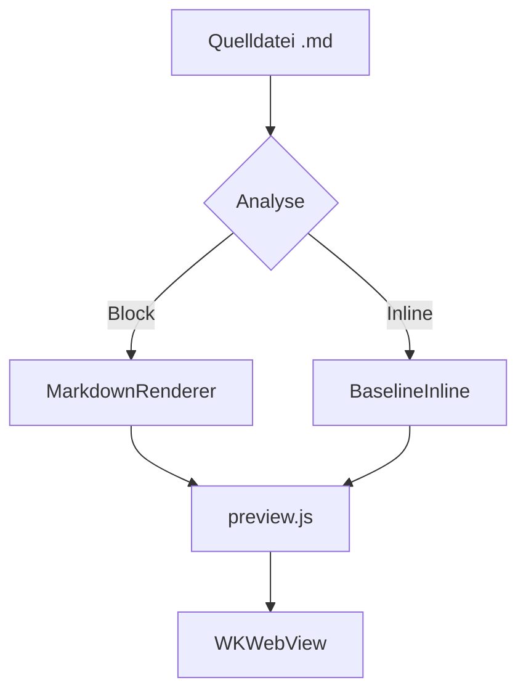
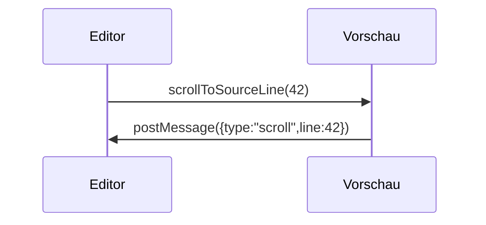

# Überblick über „MD Editor“

Nativer Markdown-Editor für macOS und iPadOS. Dieser Ausschnitt deckt **Fettschrift**, *Kursivschrift*, ~~durchgestrichenen Text~~, `Inline-Code`, <mark>Hervorhebung</mark>, die Tasten <kbd>⌘</kbd>+<kbd>K</kbd>, eine Fußnote[^1], die Formeln $E = mc^2$ und $a^2 + b^2 = c^2$ sowie oberen<sup>2</sup> und unteren<sub>2</sub> Index ab. Externer Link: [example.com/docs](https://example.com/docs "Dokumentation"), Wiki-Link: [[Notiz]], relativ: [notes/other.md](notes/other.md), Anker: [zum Abschnitt „Code“](#h-kod) und [E-Mail](mailto:hi@example.com).

## Listen

- Erste Ebene
- Mit einer verschachtelten Liste
  - Zweite Ebene — Aufzählungszeichen „Kreis“
  - Noch ein Punkt
    - Dritte Ebene — Aufzählungszeichen „Quadrat“

3. Die Nummerierung beginnt bei drei
4. Zweiter Punkt
   1. Verschachtelt — lateinische Kleinbuchstaben

### Checkliste

- [x] HTML/CSS/JS-Schicht der Vorschau erstellt
- [ ] Alle acht Themes geprüft
- [ ] Druck und Export geprüft

## Code

Inline-Code: `let preview = MDEditorPreview()`. Unten ein Block mit Hervorhebung aller Tokens des Vertrags.

```swift
// Синхронизация предпросмотра со строкой исходника
final class PreviewCoordinator: NSObject {
    private var activeLine: Int = 0
    func scrollToSourceLine(_ line: Int) {
        webView.evaluateJavaScript("MDEditorPreview.scrollToSourceLine(\(line))") + 1
    }
}
```

```diff
@@ -12,7 +12,9 @@
+let width = appearance.contentWidth
-let width = 760
 apply(width)
```

```
Блок без языка — подписи в углу быть не должно.
Очень длинная строка для проверки горизонтальной прокрутки: 0123456789 0123456789 0123456789 0123456789 0123456789 0123456789 0123456789 0123456789 0123456789 0123456789 0123456789 0123456789
```

## Zitat und Tabelle

> „Typografie ist das, was einen Text lesbar macht und nicht nur sichtbar.“
>
> > Verschachteltes Zitat zur Prüfung von Einzug und Linie.

| Funktion | macOS | iOS |
| --- | :---: | ---: |
| WKWebView-Vorschau | ja | ja |
| KaTeX und Mermaid offline | ja | ja |
| Breite Zelle, die auf dem iPhone in horizontales Scrollen übergehen muss | ja | ja |

## KaTeX-Formeln

Inline-Formel mit Dollar-Begrenzern $e^{i\pi} + 1 = 0$ und mit runden Klammern \\( \\int_0^1 x^2\\,dx = \\tfrac13 \\).

$$\frac{n!}{k!(n-k)!} = \binom{n}{k}, \qquad \sum_{i=1}^{n} i = \frac{n(n+1)}{2}$$

Blockformel in eckigen Klammern: \\[\\nabla \\cdot \\vec{E} = \\frac{\\rho}{\\varepsilon_0}\\]

Fehlerhafte Formel (sollte sichtbar werden, aber das Dokument nicht zerstören): $\frac{1}{$

Eine Formel innerhalb von Code wird nicht gerendert: `$x^2$`.

## Mermaid-Diagramme





```mermaid
graph TD
  A[Diagrammfehler] --> B[
```

## Verschiedenes

---


<details>
<summary>Eingeklappter Block</summary>
Der Inhalt wird per Klick aufgeklappt.
</details>

[^1]: Fußnote mit Rückverweis auf die Stelle im Text.
