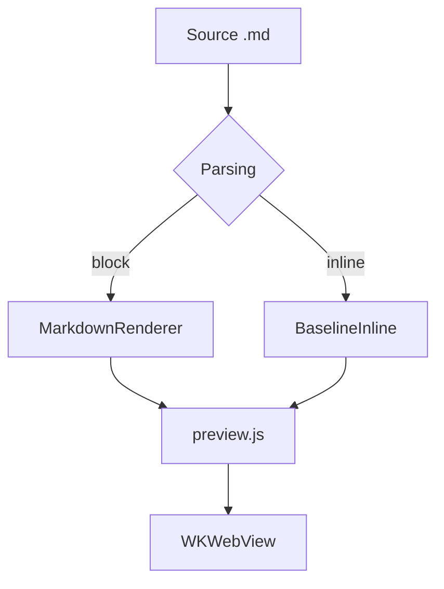
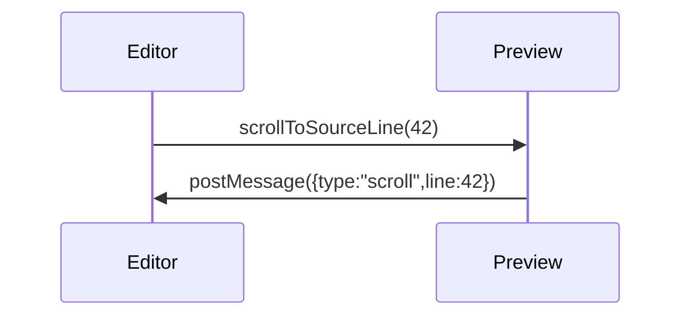

# Overview of “MD Editor”

Native Markdown editor for macOS and iPadOS. This excerpt covers **bold**, *italic*, ~~strikethrough~~, `inline code`, <mark>highlight</mark>, the <kbd>⌘</kbd>+<kbd>K</kbd> keys, a footnote[^1], the formulas $E = mc^2$ and $a^2 + b^2 = c^2$, as well as superscript<sup>2</sup> and subscript<sub>2</sub>. External link: [example.com/docs](https://example.com/docs "Documentation"), wiki link: [[Note]], relative: [notes/other.md](notes/other.md), anchor: [to the “Code” section](#h-kod) and [email](mailto:hi@example.com).

## Lists

- First level
- With a nested list
  - Second level — “circle” bullet
  - Another item
    - Third level — “square” bullet

3. Numbering starts at three
4. Second item
   1. Nested — lowercase Latin letters

### Checklist

- [x] HTML/CSS/JS preview layer built
- [ ] All eight themes checked
- [ ] Printing and export checked

## Code

Inline code: `let preview = MDEditorPreview()`. Below is a block with highlighting of all contract tokens.

```swift
// Синхронизация предпросмотра со строкой исходника
final class PreviewCoordinator: NSObject {
    private var activeLine: Int = 0
    func scrollToSourceLine(_ line: Int) {
        webView.evaluateJavaScript("MDEditorPreview.scrollToSourceLine(\(line))") + 1
    }
}
```

```diff
@@ -12,7 +12,9 @@
+let width = appearance.contentWidth
-let width = 760
 apply(width)
```

```
Блок без языка — подписи в углу быть не должно.
Очень длинная строка для проверки горизонтальной прокрутки: 0123456789 0123456789 0123456789 0123456789 0123456789 0123456789 0123456789 0123456789 0123456789 0123456789 0123456789 0123456789
```

## Quote and table

> “Typography is what makes text readable, not merely visible.”
>
> > Nested quote to check indentation and the bar.

| Feature | macOS | iOS |
| --- | :---: | ---: |
| WKWebView preview | yes | yes |
| KaTeX and Mermaid offline | yes | yes |
| A wide cell that must go into horizontal scrolling on iPhone | yes | yes |

## KaTeX formulas

Inline formula with dollar delimiters $e^{i\pi} + 1 = 0$ and with parentheses \\( \\int_0^1 x^2\\,dx = \\tfrac13 \\).

$$\frac{n!}{k!(n-k)!} = \binom{n}{k}, \qquad \sum_{i=1}^{n} i = \frac{n(n+1)}{2}$$

Block formula in square brackets: \\[\\nabla \\cdot \\vec{E} = \\frac{\\rho}{\\varepsilon_0}\\]

A formula with an error (should become noticeable but not break the document): $\frac{1}{$

A formula inside code is not rendered: `$x^2$`.

## Mermaid diagrams





```mermaid
graph TD
  A[Diagram error] --> B[
```

## Miscellaneous

---


<details>
<summary>Collapsed block</summary>
The content expands on click.
</details>

[^1]: Footnote with a backlink to the place in the text.
