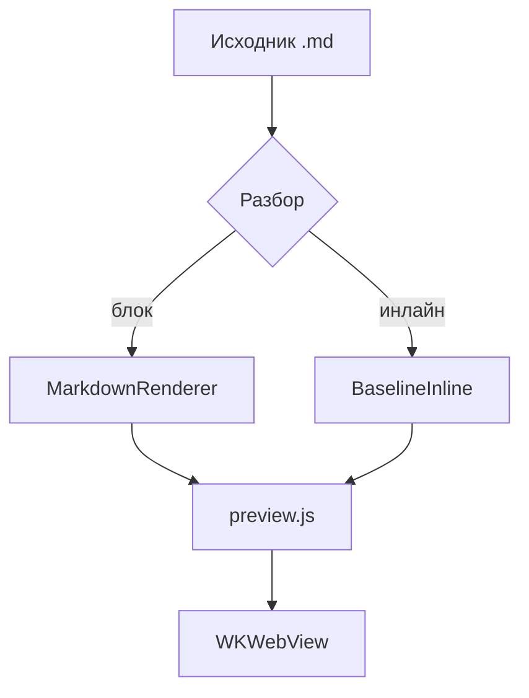
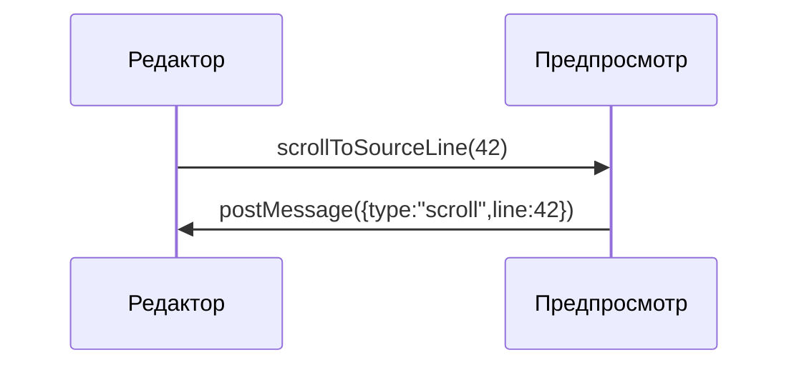

# Visión general de «MD Editor»

Editor nativo de Markdown para macOS y iPadOS. Este fragmento cubre **negrita**, *cursiva*, ~~tachado~~, `código en línea`, <mark>resaltado</mark>, las teclas <kbd>⌘</kbd>+<kbd>K</kbd>, una nota al pie[^1], las fórmulas $E = mc^2$ y $a^2 + b^2 = c^2$, así como superíndice<sup>2</sup> y subíndice<sub>2</sub>. Enlace externo: [example.com/docs](https://example.com/docs "Documentación"), enlace wiki: [[Nota]], relativo: [notes/other.md](notes/other.md), ancla: [a la sección «Código»](#h-kod) y [correo](mailto:hi@example.com).

## Listas

- Primer nivel
- Con una lista anidada
  - Segundo nivel: viñeta «círculo»
  - Otro elemento
    - Tercer nivel: viñeta «cuadrado»

3. La numeración empieza en tres
4. Segundo elemento
   1. Anidado: letras latinas minúsculas

### Lista de tareas

- [x] Capa de vista previa HTML/CSS/JS ensamblada
- [ ] Verificados los ocho temas
- [ ] Verificadas la impresión y la exportación

## Código

Código en línea: `let preview = MDEditorPreview()`. Abajo, un bloque con resaltado de todos los tokens del contrato.

```swift
// Синхронизация предпросмотра со строкой исходника
final class PreviewCoordinator: NSObject {
    private var activeLine: Int = 0
    func scrollToSourceLine(_ line: Int) {
        webView.evaluateJavaScript("MDEditorPreview.scrollToSourceLine(\(line))") + 1
    }
}
```

```diff
@@ -12,7 +12,9 @@
+let width = appearance.contentWidth
-let width = 760
 apply(width)
```

```
Блок без языка — подписи в углу быть не должно.
Очень длинная строка для проверки горизонтальной прокрутки: 0123456789 0123456789 0123456789 0123456789 0123456789 0123456789 0123456789 0123456789 0123456789 0123456789 0123456789 0123456789
```

## Cita y tabla

> «La tipografía es lo que hace que el texto sea legible, y no solo visible.»
>
> > Cita anidada para comprobar la sangría y la barra.

| Función | macOS | iOS |
| --- | :---: | ---: |
| Vista previa con WKWebView | sí | sí |
| KaTeX y Mermaid sin conexión | sí | sí |
| Celda ancha que debe desplazarse horizontalmente en el iPhone | sí | sí |

## Fórmulas de KaTeX

Fórmula en línea con delimitadores de dólar $e^{i\pi} + 1 = 0$ y con paréntesis \\( \\int_0^1 x^2\\,dx = \\tfrac13 \\).

$$\frac{n!}{k!(n-k)!} = \binom{n}{k}, \qquad \sum_{i=1}^{n} i = \frac{n(n+1)}{2}$$

Fórmula en bloque entre corchetes: \\[\\nabla \\cdot \\vec{E} = \\frac{\\rho}{\\varepsilon_0}\\]

Fórmula con error (debe destacarse, pero sin romper el documento): $\\frac{1}{$

La fórmula dentro del código no se renderiza: `$x^2$`.

## Diagramas de Mermaid





```mermaid
graph TD
  A[Ошибка диаграммы] --> B[
```

## Varios

---


<details>
<summary>Bloque plegado</summary>
El contenido se despliega al hacer clic.
</details>

[^1]: Nota al pie con un enlace de vuelta al lugar del texto.
