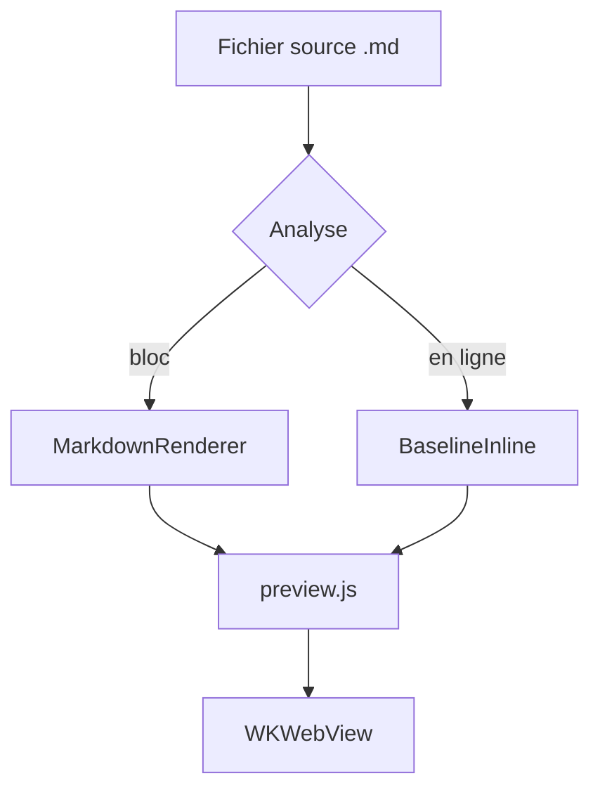
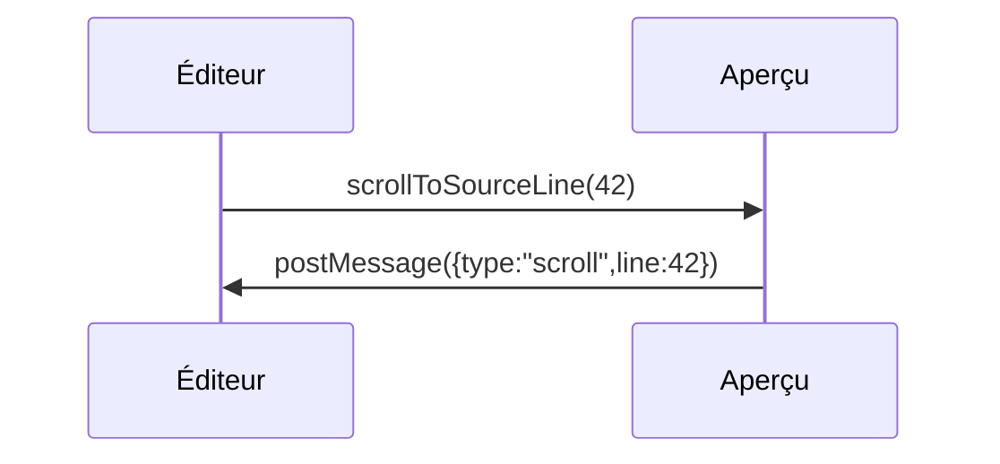

# Présentation de « MD Editor »

Éditeur Markdown natif pour macOS et iPadOS. Cet extrait couvre le **gras**, l'*italique*, le ~~barré~~, le `code en ligne`, le <mark>surlignage</mark>, les touches <kbd>⌘</kbd>+<kbd>K</kbd>, une note de bas de page[^1], les formules $E = mc^2$ et $a^2 + b^2 = c^2$, ainsi que les exposants<sup>2</sup> et les indices<sub>2</sub>. Lien externe : [example.com/docs](https://example.com/docs "Documentation"), lien wiki : [[Note]], lien relatif : [notes/other.md](notes/other.md), ancre : [vers la section « Code »](#h-kod) et [courriel](mailto:hi@example.com).

## Listes

- Premier niveau
- Avec une liste imbriquée
  - Deuxième niveau — puce « cercle »
  - Un autre point
    - Troisième niveau — puce « carré »

3. La numérotation commence à trois
4. Deuxième point
   1. Imbriqué — lettres minuscules

### Liste de tâches

- [x] Couche HTML/CSS/JS de l'aperçu assemblée
- [ ] Les huit thèmes vérifiés
- [ ] Impression et export vérifiés

## Code

Code en ligne : `let preview = MDEditorPreview()`. Ci-dessous, un bloc avec coloration de tous les jetons du contrat.

```swift
// Синхронизация предпросмотра со строкой исходника
final class PreviewCoordinator: NSObject {
    private var activeLine: Int = 0
    func scrollToSourceLine(_ line: Int) {
        webView.evaluateJavaScript("MDEditorPreview.scrollToSourceLine(\(line))") + 1
    }
}
```

```diff
@@ -12,7 +12,9 @@
+let width = appearance.contentWidth
-let width = 760
 apply(width)
```

```
Блок без языка — подписи в углу быть не должно.
Очень длинная строка для проверки горизонтальной прокрутки: 0123456789 0123456789 0123456789 0123456789 0123456789 0123456789 0123456789 0123456789 0123456789 0123456789 0123456789 0123456789
```

## Citation et tableau

> « La typographie, c'est ce qui rend un texte lisible, et non simplement visible. »
>
> > Citation imbriquée pour vérifier le retrait et la barre.

| Possibilité | macOS | iOS |
| --- | :---: | ---: |
| Aperçu WKWebView | oui | oui |
| KaTeX et Mermaid hors ligne | oui | oui |
| Cellule large qui doit passer en défilement horizontal sur iPhone | oui | oui |

## Formules KaTeX

Formule en ligne avec délimiteurs dollar $e^{i\pi} + 1 = 0$ et avec parenthèses \\( \\int_0^1 x^2\\,dx = \\tfrac13 \\).

$$\frac{n !}{k !(n-k) !} = \binom{n}{k}, \qquad \sum_{i=1}^{n} i = \frac{n(n+1)}{2}$$

Formule en bloc entre crochets : \\[\\nabla \\cdot \\vec{E} = \\frac{\\rho}{\\varepsilon_0}\\]

Formule erronée (doit devenir visible sans casser le document)  : $\frac{1}{$

Une formule à l'intérieur du code n'est pas rendue : `$x^2$`.

## Diagrammes Mermaid





```mermaid
graph TD
  A[Erreur de diagramme] --> B[
```

## Divers

---

 

<details>
<summary>Bloc replié</summary>
Le contenu se déploie au clic.
</details>

[^1] : Note de bas de page avec un lien de retour vers l'emplacement dans le texte.
