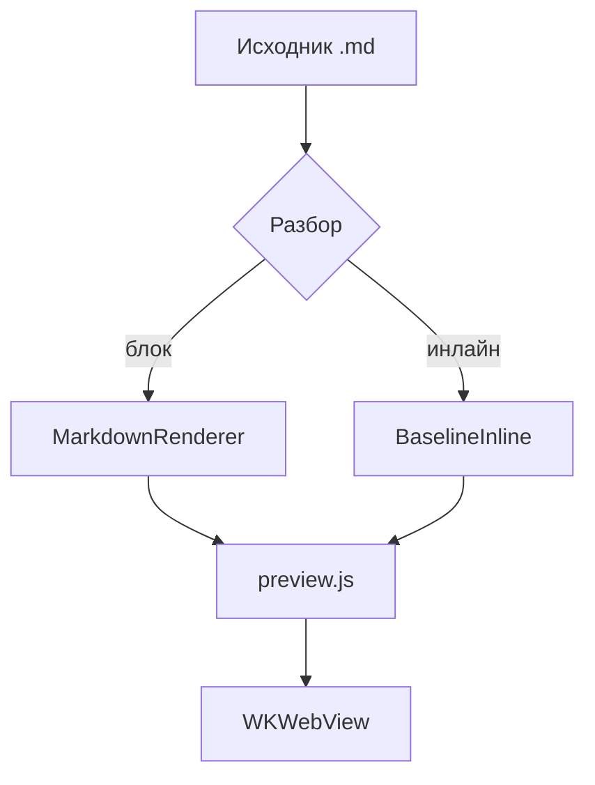
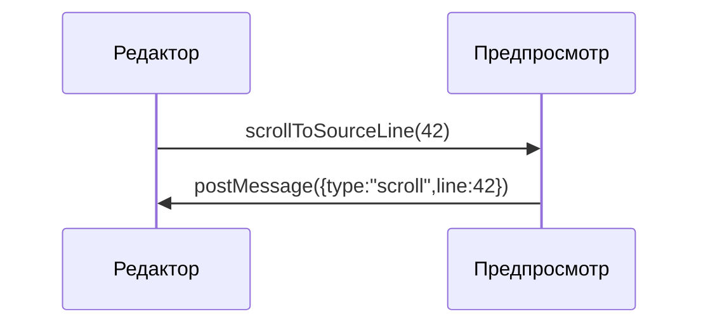

# «MD Editor» का अवलोकन

macOS और iPadOS के लिए नेटिव Markdown संपादक। यह अंश **बोल्ड**, *इटैलिक*, ~~स्ट्राइकथ्रू~~, `इनलाइन कोड`, <mark>हाइलाइट</mark>, <kbd>⌘</kbd>+<kbd>K</kbd> कुंजियाँ, एक फ़ुटनोट[^1], $E = mc^2$ और $a^2 + b^2 = c^2$ सूत्र, तथा ऊपरी<sup>2</sup> और निचले<sub>2</sub> सूचकांक शामिल करता है। बाहरी लिंक: [example.com/docs](https://example.com/docs "दस्तावेज़ीकरण"), विकी-लिंक: [[नोट]], सापेक्ष लिंक: [notes/other.md](notes/other.md), एंकर: [«कोड» अनुभाग पर](#h-kod) और [ईमेल](mailto:hi@example.com)।

## सूचियाँ

- पहला स्तर
- नेस्टेड सूची के साथ
  - दूसरा स्तर — «गोल» मार्कर
  - एक और आइटम
    - तीसरा स्तर — «वर्ग» मार्कर

3. क्रमांकन तीन से शुरू होता है
4. दूसरा आइटम
   1. नेस्टेड — छोटे लैटिन अक्षर

### चेकलिस्ट

- [x] प्रीव्यू की HTML/CSS/JS परत तैयार है
- [ ] सभी आठ थीम जाँच ली गईं
- [ ] प्रिंट और निर्यात जाँच लिया गया

## कोड

इनलाइन कोड: `let preview = MDEditorPreview()`। नीचे कॉन्ट्रैक्ट के सभी टोकन की हाइलाइटिंग वाला ब्लॉक है।

```swift
// Синхронизация предпросмотра со строкой исходника
final class PreviewCoordinator: NSObject {
    private var activeLine: Int = 0
    func scrollToSourceLine(_ line: Int) {
        webView.evaluateJavaScript("MDEditorPreview.scrollToSourceLine(\(line))") + 1
    }
}
```

```diff
@@ -12,7 +12,9 @@
+let width = appearance.contentWidth
-let width = 760
 apply(width)
```

```
Блок без языка — подписи в углу быть не должно.
Очень длинная строка для проверки горизонтальной прокрутки: 0123456789 0123456789 0123456789 0123456789 0123456789 0123456789 0123456789 0123456789 0123456789 0123456789 0123456789 0123456789
```

## उद्धरण और टेबल

> «टाइपोग्राफ़ी वह है जो टेक्स्ट को पढ़ने योग्य बनाती है, केवल दिखाई देने योग्य नहीं।»
>
> > इंडेंट और पट्टी की जाँच के लिए नेस्टेड उद्धरण।

| सुविधा | macOS | iOS |
| --- | :---: | ---: |
| WKWebView प्रीव्यू | हाँ | हाँ |
| KaTeX और Mermaid ऑफ़लाइन | हाँ | हाँ |
| चौड़ी सेल, जो iPhone पर क्षैतिज स्क्रॉल में जानी चाहिए | हाँ | हाँ |

## KaTeX सूत्र

डॉलर डेलिमिटर वाला इनलाइन सूत्र $e^{i\pi} + 1 = 0$ और गोल कोष्ठकों वाला \\( \\int_0^1 x^2\\,dx = \\tfrac13 \\).

$$\frac{n!}{k!(n-k)!} = \binom{n}{k}, \qquad \sum_{i=1}^{n} i = \frac{n(n+1)}{2}$$

वर्ग कोष्ठकों में ब्लॉक सूत्र: \\[\\nabla \\cdot \\vec{E} = \\frac{\\rho}{\\varepsilon_0}\\]

त्रुटि वाला सूत्र (ध्यान खींचना चाहिए, पर दस्तावेज़ को न तोड़े): $\frac{1}{$

कोड के अंदर सूत्र रेंडर नहीं होता: `$x^2$`।

## Mermaid आरेख





```mermaid
graph TD
  A[Ошибка диаграммы] --> B[
```

## अन्य

---


<details>
<summary>संकुचित ब्लॉक</summary>
सामग्री क्लिक पर खुलती है।
</details>

[^1]: टेक्स्ट में अपने स्थान पर वापस जाने वाला लिंक रखने वाला फ़ुटनोट।
