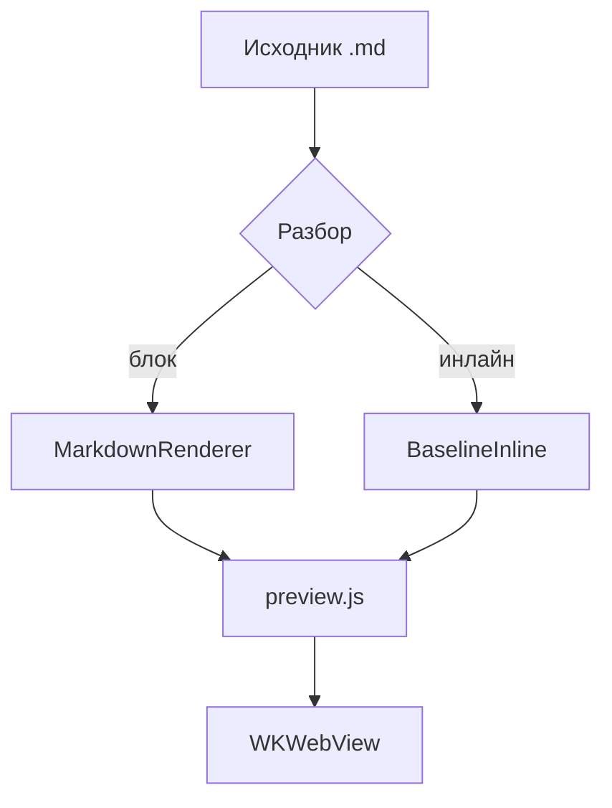
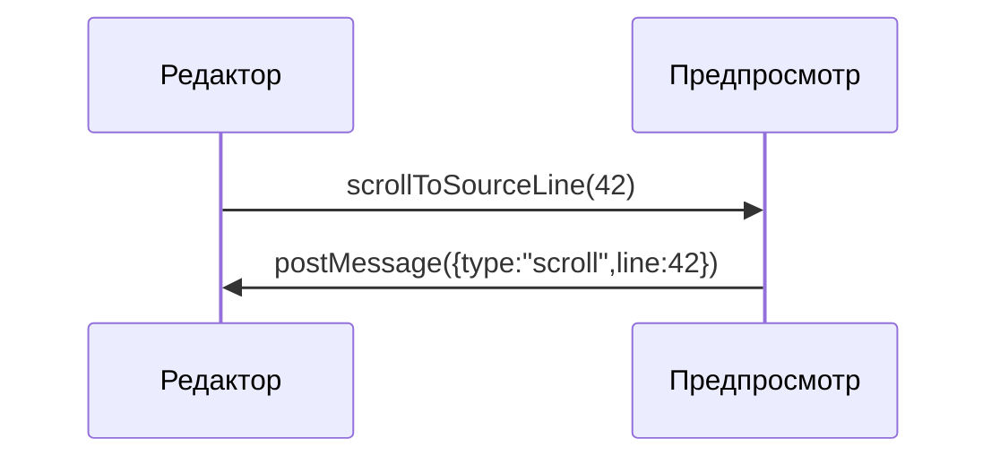

# Обзор «MD Editor»

Нативный редактор Markdown для macOS и iPadOS. Этот фрагмент покрывает **жирный**, *курсив*, ~~зачёркнутый~~, `инлайн-код`, <mark>выделение</mark>, клавиши <kbd>⌘</kbd>+<kbd>K</kbd>, сноску[^1], формулы $E = mc^2$ и $a^2 + b^2 = c^2$, а также верхний<sup>2</sup> и нижний<sub>2</sub> индексы. Внешняя ссылка: [example.com/docs](https://example.com/docs "Документация"), вики-ссылка: [[Заметка]], относительная: [notes/other.md](notes/other.md), якорь: [к разделу «Код»](#h-kod) и [письмо](mailto:hi@example.com).

## Списки

- Первый уровень
- Со вложенным списком
  - Второй уровень — маркер «кружок»
  - Ещё пункт
    - Третий уровень — маркер «квадрат»

3. Нумерация начинается с трёх
4. Второй пункт
   1. Вложенный — строчная латиница

### Чек-лист

- [x] Собран HTML/CSS/JS-слой предпросмотра
- [ ] Проверены все восемь тем
- [ ] Проверена печать и экспорт

## Код

Инлайн-код: `let preview = MDEditorPreview()`. Ниже блок с подсветкой всех токенов контракта.

```swift
// Синхронизация предпросмотра со строкой исходника
final class PreviewCoordinator: NSObject {
    private var activeLine: Int = 0
    func scrollToSourceLine(_ line: Int) {
        webView.evaluateJavaScript("MDEditorPreview.scrollToSourceLine(\(line))") + 1
    }
}
```

```diff
@@ -12,7 +12,9 @@
+let width = appearance.contentWidth
-let width = 760
 apply(width)
```

```
Блок без языка — подписи в углу быть не должно.
Очень длинная строка для проверки горизонтальной прокрутки: 0123456789 0123456789 0123456789 0123456789 0123456789 0123456789 0123456789 0123456789 0123456789 0123456789 0123456789 0123456789
```

## Цитата и таблица

> «Типографика — это то, что делает текст читаемым, а не просто видимым.»
>
> > Вложенная цитата для проверки отступа и полосы.

| Возможность | macOS | iOS |
| --- | :---: | ---: |
| Предпросмотр WKWebView | да | да |
| KaTeX и Mermaid офлайн | да | да |
| Широкая ячейка, которая должна уезжать в горизонтальный скролл на iPhone | да | да |

## Формулы KaTeX

Строчная формула с делимитерами доллара $e^{i\pi} + 1 = 0$ и с круглыми скобками \\( \\int_0^1 x^2\\,dx = \\tfrac13 \\).

$$\frac{n!}{k!(n-k)!} = \binom{n}{k}, \qquad \sum_{i=1}^{n} i = \frac{n(n+1)}{2}$$

Блочная формула в квадратных скобках: \\[\\nabla \\cdot \\vec{E} = \\frac{\\rho}{\\varepsilon_0}\\]

Формула с ошибкой (должна стать заметной, но не ломать документ): $\frac{1}{$

Формула внутри кода не рендерится: `$x^2$`.

## Диаграммы Mermaid





```mermaid
graph TD
  A[Ошибка диаграммы] --> B[
```

## Разное

---


<details>
<summary>Свёрнутый блок</summary>
Содержимое раскрывается по клику.
</details>

[^1]: Сноска с обратной ссылкой на место в тексте.
