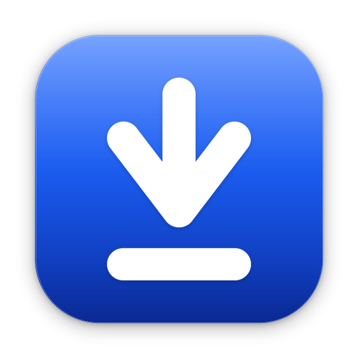
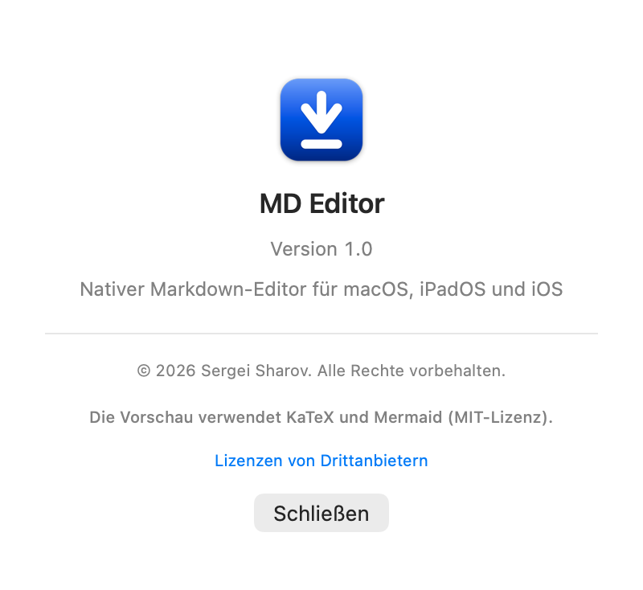
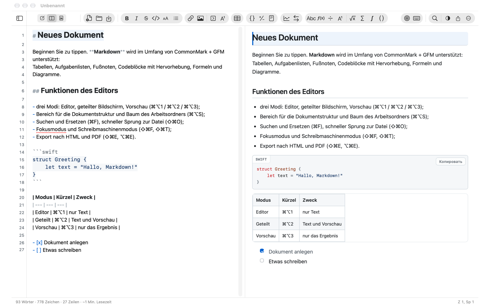
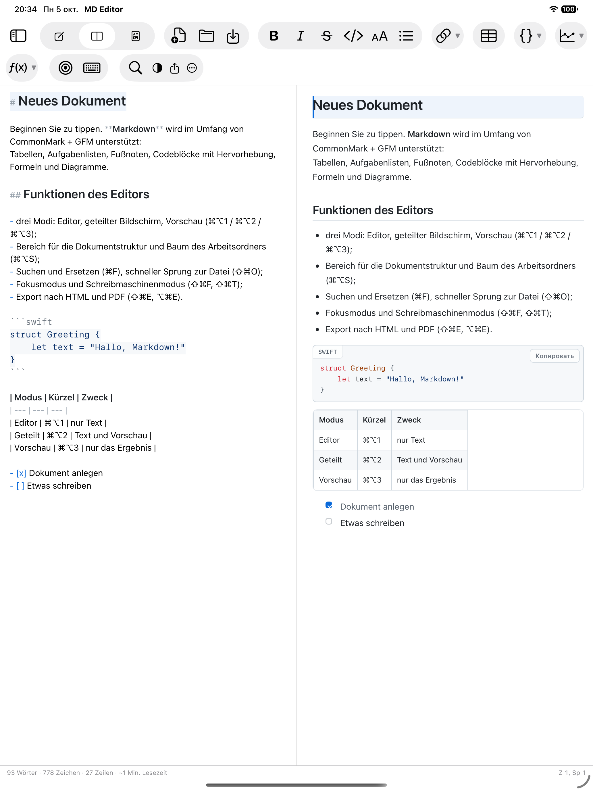
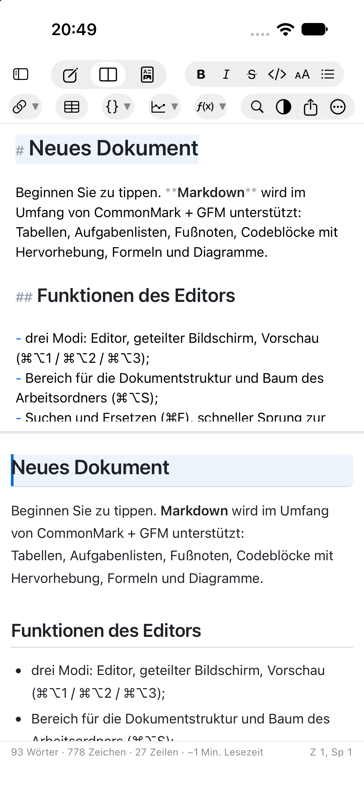
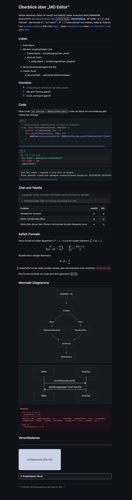
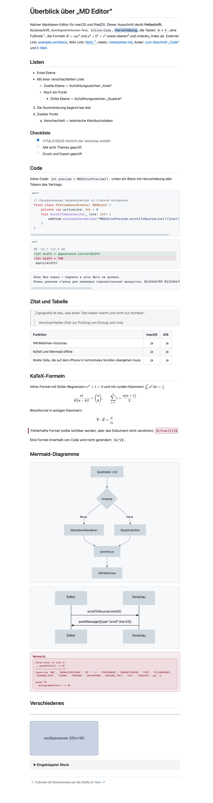

[Русский](README.md) | [English](README.en.md) | **Deutsch** | [Español](README.es.md) | [Français](README.fr.md) | [हिन्दी](README.hi.md)

   [](LICENSE)

# MD Editor

Eine plattformübergreifende App für macOS, iPadOS und iOS zum Anzeigen und Bearbeiten von
Dateien im Format **Markdown**. Die Oberfläche folgt der Logik eines klassischen
Texteditors: Dokumentfenster, Werkzeugleiste, Menü mit vertrauten Tastenkürzeln,
Statuszeile.

* Nur `.md`-Dateien: keine Datenbank, keine „eigenen“ Formate. Jedes Dokument ist eine
  gewöhnliche Textdatei, die in Git, iCloud Drive oder Obsidian liegen kann.
* Ein Code und eine Oberfläche für macOS, iPadOS und iOS: Kern und Interface sind gemeinsam,
  die Unterschiede stecken nur in den Plattform-Direktiven `#if os(...)`.
* Vollständig offline: keine einzige Fremdabhängigkeit zur Laufzeit, KaTeX und Mermaid
  sind einkompiliert.



Entwickelt von **Sergei Sharov**. Angaben zum Autor sind in der App im Abschnitt
„Über das Programm“ zu sehen (⌘-Menü auf macOS, Schaltfläche „…“ in der Werkzeugleiste
auf iPad/iPhone):



### So sieht es aus

| macOS | iPadOS |
|---|---|
|  |  |

Auf dem iPhone liegen dieselben Bereiche untereinander:

| iPhone |
|---|
|  |

Links der Editor mit Markdown-Hervorhebung (Auszeichnungsmarker sind gedämpft, Überschriften
größer), rechts die Vorschau: Überschriften, Listen, Aufgabenlisten, Codeblock mit
Sprachangabe, Tabelle mit Ausrichtung. Die Gestaltung der Vorschau (dieselben Themen gelten
auch beim Export):

| Dunkles Thema | Helles Thema |
|---|---|
|  |  |

Die Screenshots stammen aus [`Docs/demo.de.md`](Docs/demo.de.md) — einem Demonstrationsdokument,
das alle Möglichkeiten der Vorschau abdeckt: Hervorhebung, drei Listenebenen, Aufgabenliste,
Codeblöcke (swift, diff und ohne Sprachangabe), Zitat, Tabelle mit Ausrichtung, KaTeX-Formeln
mit allen vier Begrenzern, Mermaid-Diagramme, HTML-Blöcke, Fußnote und eingebettetes Bild.
Zum Nachvollziehen:

```bash
"MD Editor.app/Contents/MacOS/MD Editor" --preview-snapshot Docs/demo.md /tmp/demo.png github-light
```

---

## 1. Was die App kann

### Modi und Navigation
* Drei Modi: **Editor**, **geteilter Bildschirm**, **Vorschau** (⌘⌥1 / ⌘⌥2 / ⌘⌥3).
* Scroll-Synchronisierung in beide Richtungen: Scrollen im Editor führt die Vorschau mit,
  Scrollen in der Vorschau den Editor (über Zeilennummern).
* Werkzeugleiste: Link, Bild, **eingeklappter Block** und **Fußnote mit Rückverweis**,
  Tabelle, drei **Codeblöcke** (Swift, diff, ohne Sprachangabe — jeder mit eigenem Beispiel),
  zwei **Diagramme** (Flussdiagramm, Sequenzdiagramm) und acht **Formeln** (inline, als Block,
  Bruch, Index und Exponent, Wurzel, Summe, Integral, Binomialkoeffizient). Die Schaltflächen
  sind wie in der „Mail“-Leiste in „Kapseln“ gruppiert: große Symbole, deutliche Gruppenfläche;
  Blöcke werden in eigenen Zeilen eingefügt, der Platzhalter wird zum Ersetzen markiert.
* Seitenleiste: **Dokumentstruktur** (Überschriften H1–H6 mit Sprung per Klick) und
  **Baum des Arbeitsordners** (jeder Ordner mit `.md`, wird einmal geöffnet und über ein
  security-scoped bookmark gemerkt).
* Schneller Sprung zur Datei per unscharfer Suche (⇧⌘O), Suche/Filter im Dateibaum.
* Versionsverlauf des Dokuments: lokale Snapshots mit Ansicht und Wiederherstellung (⌃⌘H).

### Editor
* Markdown-Hervorhebung: unterschiedlich große Überschriften, fett/kursiv/durchgestrichen,
  Inline-Code, Codeblöcke mit Syntaxhervorhebung (20 Sprachen), Links, Listenmarker, Zitate,
  Tabellen, Front Matter. Auszeichnungsmarker sind gedämpft — „fast WYSIWYG“, wie in iA Writer.
* Intelligente Eingabe: Fortsetzen von Listen und Nummerierungen mit Enter, Tab/Shift+Tab für
  Verschachtelung, automatische Paare `(` `[` `` ` `` `*` `_` `~` `"` `'`, Umhüllen der Auswahl.
* Bilder einfügen per ⌘V und Drag & Drop: Die Datei wird in `assets/` neben den Notizen
  kopiert, im Text erscheint ein relativer Link. Pfade mit Leerzeichen, Klammern und
  kyrillischen Zeichen werden lesbar (in spitzen Klammern) geschrieben und öffnen sich in der
  Vorschau korrekt.
* Zeilennummern, Hervorhebung der aktuellen Zeile, Fokusmodus (⌘⇧F) und Schreibmaschinenmodus
  (⌘⇧T), Rechtschreibprüfung, deaktivierte „smarte“ Anführungszeichen (damit Markdown nicht
  beschädigt wird).
* Suchen und Ersetzen mit Hervorhebung aller Treffer, Berücksichtigung von Groß-/Kleinschreibung,
  ganzen Wörtern und regulären Ausdrücken (⌘F / ⌥⌘F).
* Vollständiges Undo/Redo, Autospeichern, Dokument-„Versionen“ mit Systemmitteln.

### Markdown
* CommonMark + GFM: ATX- und Setext-Überschriften, Listen (verschachtelt, „dicht“ und „locker“),
  Aufgabenlisten mit **anklickbaren** Kontrollkästchen direkt in der Vorschau, Tabellen mit
  Ausrichtung, Zitate, Codeblöcke, Fußnoten, Autolinks, HTML-Blöcke, Front Matter YAML.
* Die Schaltfläche „Tabelle“ fügt drei Spalten, eine Kopfzeile und **drei Datenzeilen** ein;
  die Tabellenzeilen sind gleich hoch, auch solange die Zellen leer sind.
* KaTeX-Mathematik (`$…$`, `$$…$$`) und Mermaid-Diagramme — **offline**, aus einkompilierten
  Bibliotheken.
* Wiki-Links `[[Notiz]]` mit Sprung zu Dateien des Arbeitsordners.
* Harte Zeilenumbrüche (wie auf GitHub): Ein einzelner Zeilenumbruch in einem Absatz wird in
  der Vorschau als echte Zeile dargestellt, daher stimmen die Zeilen von Editor und Vorschau
  überein (Einstellung „Markdown → Harte Zeilenumbrüche“, standardmäßig aktiviert).
* „Fast WYSIWYG“ bei Auszeichnungen: Ein Leerzeichen innerhalb von `** … **` stört Fett und
  Durchstreichen nicht — weder in der Editor-Hervorhebung noch in der Vorschau.

### Gestaltung
* 8 Vorschau-Themen mit eigenen Namen: **Kreide**, **Schiefer**, **Papier**, **Pergament**,
  **Sand**, **Ozean**, **Arktis**, **Tinte** (im englischen Interface: Chalk, Slate, Paper,
  Parchment, Sand, Ocean, Arctic, Ink). Standardmäßig folgt das helle/dunkle Schema dem System;
  schaltet man „Dem System-Erscheinungsbild folgen“ aus, bestimmt das gewählte Thema das Schema
  **des gesamten Fensters** — Editor, Bereiche und Titelleiste, nicht nur die Vorschau.
* Typografie-Einstellungen: Schriftfamilie und -größe, Zeilenabstand, Spaltenbreite, Abstände
  zwischen Absätzen, Blocksatz, Silbentrennung.
* Die Schriftfamilie ist **für Editor und Vorschau gemeinsam** (Tab „Editor“), die Größe der
  Vorschau ist eine eigene (Tab „Vorschau“); beim ersten Start sind die Größen gleich, danach
  ändern sie sich unabhängig voneinander.
* Bildlaufleisten in Editor und Vorschau sind immer sichtbar: So ist sofort klar, ob es
  Scrollen gibt und wo sich der Text befindet.

### Export
* Eigenständiges HTML (alles eingebettet, einschließlich Formelschriften und **Bildern**),
  PDF, Drucken.
* Bilder werden in die fertige Datei eingebettet (in PDF und beim Drucken immer): Das Dokument
  hängt nicht davon ab, wo die Originalbilder liegen.
* Der Export verändert das Dokument nicht und erfordert kein Schreiben daneben.

### Plattformen
* macOS 14+ — Haupt-Target, Dokumentfenster, Menü, „Teilen“, Drucken.
* iOS 17+ / iPadOS — dieselbe Oberfläche: Auf schmalen Bildschirmen wird die Seitenleiste zu
  einer ausziehbaren Schublade, die Bereiche von Editor und Vorschau bleiben gleich.
* Lokalisierung in sechs Sprachen: Russisch, Englisch, Deutsch, Spanisch, Französisch und
  Hindi — die Oberfläche folgt der Systemsprache.
* Eingebaute Hilfe: Sie öffnet sich über das Hilfe-Menü (⌘?) und auf iPhone/iPad über das
  Menü „Mehr“; der Text liegt in `MDEditor/de.lproj/Help.md` und ist in sechs Sprachen
  übersetzt.
* Abschnitt „Über das Programm“ mit Angaben zum Autor.

---

## 2. Tastenkürzel

Ein Dokument — ein Fenster. „Neues Dokument“ (⌘N) und „Öffnen“ (⌘O) arbeiten **im aktuellen
Fenster**: Zuerst wird nach ungespeicherten Änderungen gefragt, dann wird das Dokument ersetzt.
Neue Fenster entstehen dabei nicht.

| Aktion | Kürzel |
|---|---|
| Editor / Geteilt / Vorschau | ⌘⌥1 / ⌘⌥2 / ⌘⌥3 |
| Seitenleiste | ⌘⌥S |
| Schneller Sprung zur Datei | ⇧⌘O |
| Arbeitsordner öffnen | ⌃⌘O |
| Suchen / Suchen und Ersetzen | ⌘F / ⌥⌘F |
| Weitersuchen / rückwärts suchen | ⌘G / ⇧⌘G |
| Fett / Kursiv / Durchgestrichen | ⌘B / ⌘I / ⌃⌘X |
| Inline-Code / Codeblock (Swift) | ⌃⌘C / ⌃⌘K |
| Codeblock Diff / ohne Sprachangabe | — (Schaltflächen der Werkzeugleiste) |
| Eingeklappter Block | ⌥⌘E |
| Überschriften 1–6 / Überschrift entfernen | ⌘1…⌘6 / ⌘0 |
| Aufzählung / Nummerierung / Aufgabenliste | ⌥⌘U / ⌥⌘O / ⌥⌘L |
| Zitat / Horizontale Linie | ⌥⌘Q / ⌥⌘H |
| Link / Bild | ⌘K / ⇧⌘I |
| Tabelle / Inhaltsverzeichnis / Fußnote | ⌥⌘T / ⌃⌘T / ⌃⌘F |
| Flussdiagramm / Formelblock | ⌥⌘D / ⌥⌘M |
| Formel / Mermaid-Diagramm | ⌥⌘M / ⌥⌘D |
| Fokusmodus / Schreibmaschinenmodus | ⇧⌘F / ⇧⌘T |
| Scroll-Synchronisierung | ⇧⌘L |
| Statuszeile | ⌥⌘W |
| Export HTML / PDF | ⇧⌘E / ⌥⌘E |
| Drucken | ⌘P |
| Verlaufs-Snapshot / Versionsverlauf | ⌃⌘S / ⌃⌘H |
| Einstellungen | ⌘, |

---

## 3. Fremdkomponenten

| Komponente | Version | Lizenz | Zweck |
|---|---|---|---|
| [KaTeX](https://katex.org) | 0.16.11 | MIT | Darstellung der Formeln `$…$`, `$$…$$` |
| [Mermaid](https://mermaid.js.org) | 11.4.1 | MIT | Diagramme in Blöcken ```` ```mermaid ```` |

Beide Bibliotheken liegen in `Web/vendor/` zusammen mit den Lizenztexten und werden lokal
geladen — das Internet ist nicht erforderlich.

Die vollständigen Lizenztexte sind in der App zu sehen: „Über MD Editor“ → „Lizenzen von Drittanbietern“.

---

## 4. Lizenz

MD Editor ist proprietäre Software: © 2026 Sergei Sharov, alle Rechte vorbehalten. Die
Bedingungen stehen in der Datei [LICENSE](LICENSE).

Die Komponenten von Drittanbietern (KaTeX und Mermaid) stehen unter der MIT-Lizenz: ihre
Texte liegen in `Web/vendor/licenses/` und sind in der App zu sehen — „Über MD Editor“ →
„Lizenzen von Drittanbietern“.
