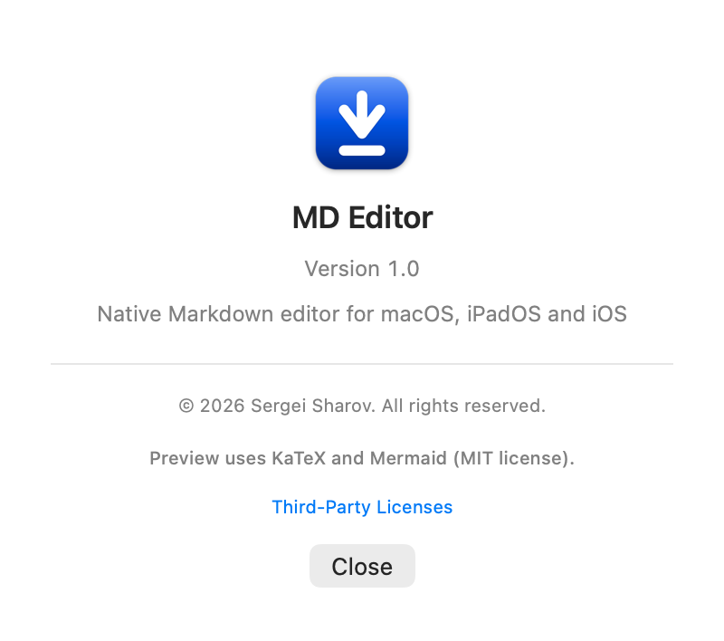
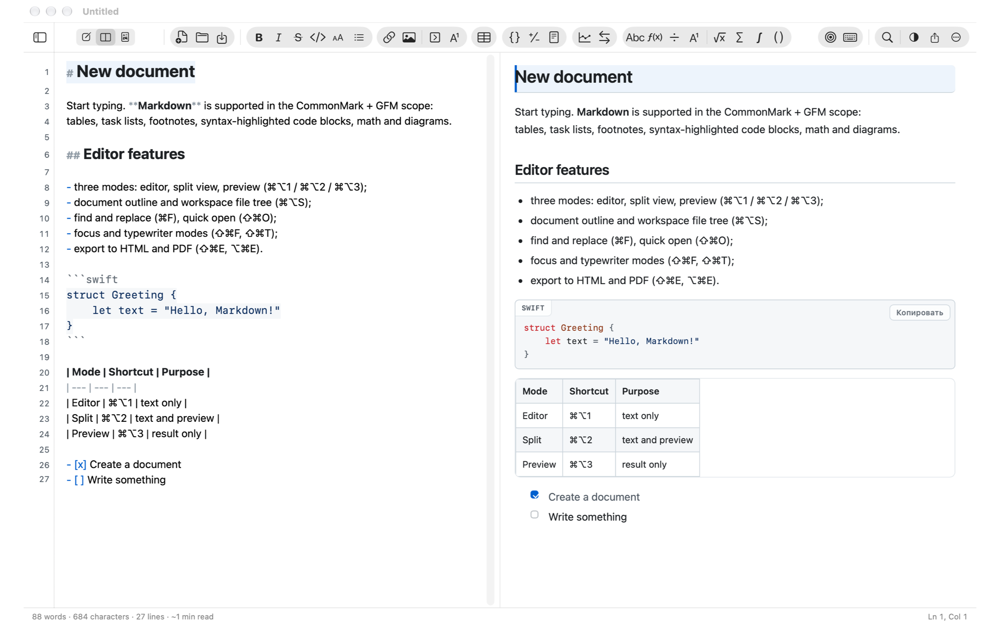
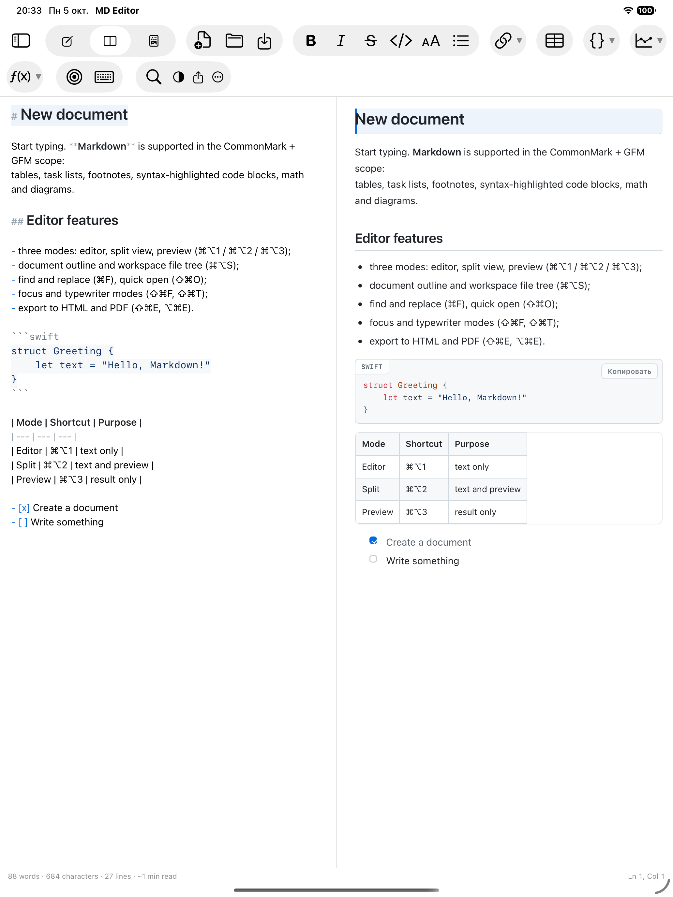
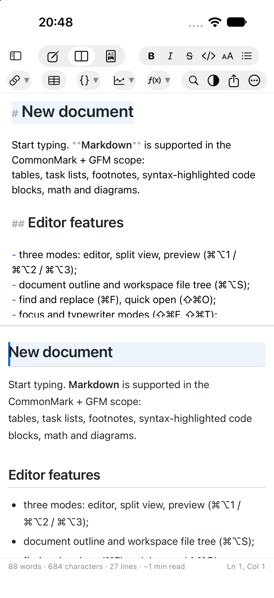
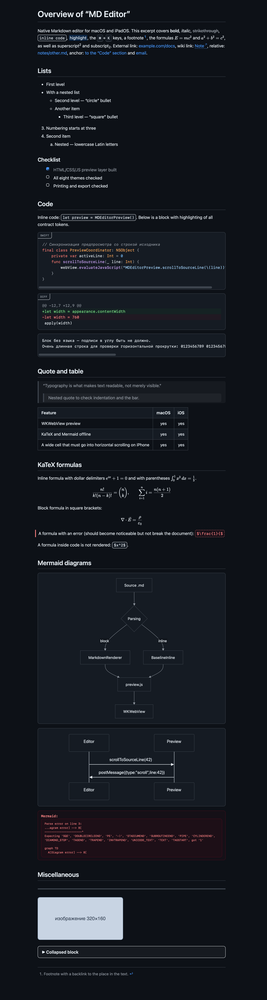
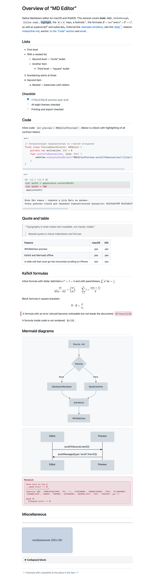

[Русский](README.md) | **English** | [Deutsch](README.de.md) | [Español](README.es.md) | [Français](README.fr.md) | [हिन्दी](README.hi.md)

   [](LICENSE)

# MD Editor

A cross-platform app for macOS, iPadOS, and iOS for viewing and editing **Markdown**
files. The interface follows the logic of a standard text editor: a document window,
a toolbar, menus with familiar keyboard shortcuts, and a status bar.

* `.md` files only: no database, no "custom" formats. Every document is an ordinary
  text file that you can put in Git, iCloud Drive, or Obsidian.
* One codebase and one design for Mac, iPad, and iPhone: the core and the interface are
  shared, and the differences live in three or four files with `#if os(...)` directives.
* Fully offline: not a single third-party dependency at runtime, with KaTeX and Mermaid
  compiled in.
* Built-in **help** (⌘? or the "More" menu on iPhone/iPad): sections about modes,
  insertion, search, themes, export, and keyboard shortcuts — in all six app languages.


Developed by **Sergei Sharov**. Author details are visible in the app under
"About" (the ⌘ menu on macOS, the "…" button in the toolbar on iPad/iPhone):



### What it looks like

| macOS | iPadOS |
|---|---|
|  |  |

On iPhone the same panes are stacked one below the other:

| iPhone |
|---|
|  |

On the left is the editor with Markdown highlighting (markup markers are dimmed,
headings are larger); on the right is the preview: headings, lists, checklists, a code
block with a language label, a table with alignment. Preview styling (the same themes
work in export too):

| Dark theme | Light theme |
|---|---|
|  |  |

The screenshots were taken from [`Docs/demo.en.md`](Docs/demo.en.md) — a demo document
that covers every preview capability: highlighting, three levels of lists, a checklist,
code blocks (swift, diff, and no language), a blockquote, a table with alignment, KaTeX
formulas with all four delimiters, Mermaid diagrams, HTML blocks, a footnote, and an
embedded image. To reproduce:

```bash
"MD Editor.app/Contents/MacOS/MD Editor" --preview-snapshot Docs/demo.md /tmp/demo.png github-light
```

---

## 1. What the app can do

### Modes and navigation
* Three modes: **editor**, **split screen**, **preview** (⌘⌥1 / ⌘⌥2 / ⌘⌥3).
* Two-way scroll synchronization: scrolling the editor drives the preview, and scrolling
  the preview drives the editor (by line numbers).
* Toolbar: link, image, **collapsible block**, and **footnote with a back
  reference**, table, three **code blocks** (Swift, diff, no language — each with its own
  example), two **diagrams** (flowchart, sequence), and eight **formulas**
  (inline, block, fraction, subscript and superscript, root, sum, integral, binomial
  coefficient). The buttons are grouped into "capsules", as in the Mail toolbar: large
  icons, a prominent group background; blocks are placed on their own lines, and the
  placeholder is selected for replacement.
* Sidebar: **document outline** (H1–H6 headings with click-to-navigate) and the
  **working folder tree** (any folder with `.md` files; it is opened once and remembered
  through a security-scoped bookmark).
* Quick file jump by fuzzy search (⇧⌘O), plus search/filter in the file tree.
* Document version history: local snapshots with viewing and restoring (⌃⌘H).

### Editor
* Markdown highlighting: headings at different sizes, bold/italic/strikethrough, inline
  code, code blocks with syntax highlighting (20 languages), links, list markers,
  blockquotes, tables, front matter. Markup markers are dimmed — "almost WYSIWYG", like
  in iA Writer.
* Smart input: continuing lists and numbering on Enter, Tab/Shift+Tab for nesting,
  auto-pairs for `(` `[` `` ` `` `*` `_` `~` `"` `'`, and wrapping the selection.
* Image insertion via ⌘V and drag & drop: the file is copied into `assets/` next to the
  notes, and a relative link is inserted into the text. Paths with spaces, parentheses,
  and Cyrillic characters are written readably (in angle brackets) and open correctly in
  the preview.
* Line numbers, current-line highlighting, focus mode (⌘⇧F), and typewriter
  mode (⌘⇧T), spell checking, and "smart" quotes disabled (so they don't corrupt
  Markdown).
* Find and replace with highlighting of all occurrences, case sensitivity, whole words,
  and regular expressions (⌘F / ⌥⌘F).
* Fully featured Undo/Redo, autosave, and system document "Versions".

### Markdown
* CommonMark + GFM: ATX and Setext headings, lists (nested, "tight", and "loose"),
  checklists with **clickable** checkboxes right in the preview, tables with alignment,
  blockquotes, code blocks, footnotes, autolinks, HTML blocks, and YAML front matter.
* The "table" button inserts three columns, a header row, and **three data rows**;
  table rows keep the same height even while the cells are empty.
* KaTeX math (`$…$`, `$$…$$`) and Mermaid diagrams — **offline**, from compiled-in
  libraries.
* Wiki links `[[Note]]` with navigation across the files of the working folder.
* Hard line breaks (as on GitHub): a single newline in a paragraph is shown in the
  preview as a real line break, so editor and preview lines match
  (the "Markdown → Hard line breaks" setting, on by default).
* "Almost WYSIWYG" emphasis: a space inside `** … **` doesn't prevent bold and
  strikethrough — both in the editor highlighting and in the preview.

### Appearance
* 8 preview themes with their own names: **Chalk**, **Slate**, **Paper**, **Parchment**,
  **Sand**, **Ocean**, **Arctic**, **Ink**. By default the light/dark scheme
  follows the system; if you turn off "Follow system appearance", the selected theme
  sets the scheme for the **entire window** — the editor, the panels, and the title bar,
  not just the preview.
* Typography settings: font family and size, line spacing, column width,
  paragraph spacing, justification, and hyphenation.
* The font family is **shared between the editor and the preview** (the "Editor" tab),
  while the preview has its own size (the "Preview" tab); on first launch the sizes are
  equal, and after that they change independently.
* Scrollbars in the editor and preview are always visible: they immediately show
  whether there is anything to scroll and where the text is.

### Export
* Standalone HTML (everything embedded, including formula fonts and **images**), PDF, and printing.
* Images are embedded into the output file (in PDF and when printing — always): the
  document doesn't depend on where the source images live.
* Export doesn't modify the document and doesn't require writing next to it.

### Platforms
* macOS 14+ — the primary target: document windows, menus, "Share", printing.
* iOS 17+ / iPadOS — the same interface: on narrow screens the sidebar turns into
  a slide-out drawer, while the editor and preview panes stay the same.
* Localization into six languages: Russian, English, German, Spanish, French,
  and Hindi — the interface follows the system language.
* An "About" section with information about the author.

---

## 2. Keyboard shortcuts

One document — one window. "New document" (⌘N) and "Open" (⌘O) work
**in the current window**: they first ask about unsaved changes and then replace the
document. No new windows appear.

| Action | Shortcut |
|---|---|
| Editor / Split / Preview | ⌘⌥1 / ⌘⌥2 / ⌘⌥3 |
| Sidebar | ⌘⌥S |
| Quick file jump | ⇧⌘O |
| Open working folder | ⌃⌘O |
| Find / Find and replace | ⌘F / ⌥⌘F |
| Find next / previous | ⌘G / ⇧⌘G |
| Bold / Italic / Strikethrough | ⌘B / ⌘I / ⌃⌘X |
| Inline code / Code block (Swift) | ⌃⌘C / ⌃⌘K |
| Diff / no-language code block | — (toolbar buttons) |
| Collapsible block | ⌥⌘E |
| Headings 1–6 / clear heading | ⌘1…⌘6 / ⌘0 |
| Bulleted / Numbered / Checklist | ⌥⌘U / ⌥⌘O / ⌥⌘L |
| Blockquote / Horizontal rule | ⌥⌘Q / ⌥⌘H |
| Link / Image | ⌘K / ⇧⌘I |
| Table / Table of contents / Footnote | ⌥⌘T / ⌃⌘T / ⌃⌘F |
| Flowchart / Formula block | ⌥⌘D / ⌥⌘M |
| Formula / Mermaid diagram | ⌥⌘M / ⌥⌘D |
| Focus mode / Typewriter mode | ⇧⌘F / ⇧⌘T |
| Scroll synchronization | ⇧⌘L |
| Status bar | ⌥⌘W |
| Export HTML / PDF | ⇧⌘E / ⌥⌘E |
| Print | ⌘P |
| History snapshot / Version history | ⌃⌘S / ⌃⌘H |
| Settings | ⌘, |

---

## 3. Third-party components

| Component | Version | License | Purpose |
|---|---|---|---|
| [KaTeX](https://katex.org) | 0.16.11 | MIT | rendering `$…$`, `$$…$$` formulas |
| [Mermaid](https://mermaid.js.org) | 11.4.1 | MIT | diagrams in ```` ```mermaid ```` blocks |

Both libraries live in `Web/vendor/` together with the license texts
and are loaded locally — no internet required.

The full license texts are available in the app: “About MD Editor” → “Third-Party Licenses”.

---

## 4. License

MD Editor is proprietary software: © 2026 Sergei Sharov, all rights reserved. See the
[LICENSE](LICENSE) file for the terms.

The third-party components (KaTeX and Mermaid) are distributed under the MIT license:
their texts are in `Web/vendor/licenses/` and are available in the app — “About MD Editor”
→ “Third-Party Licenses”.
