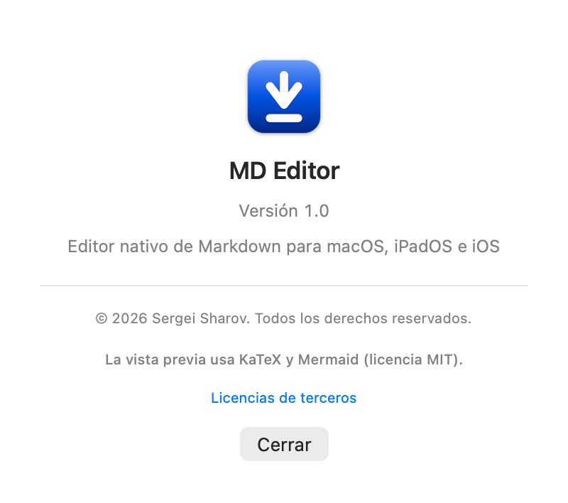
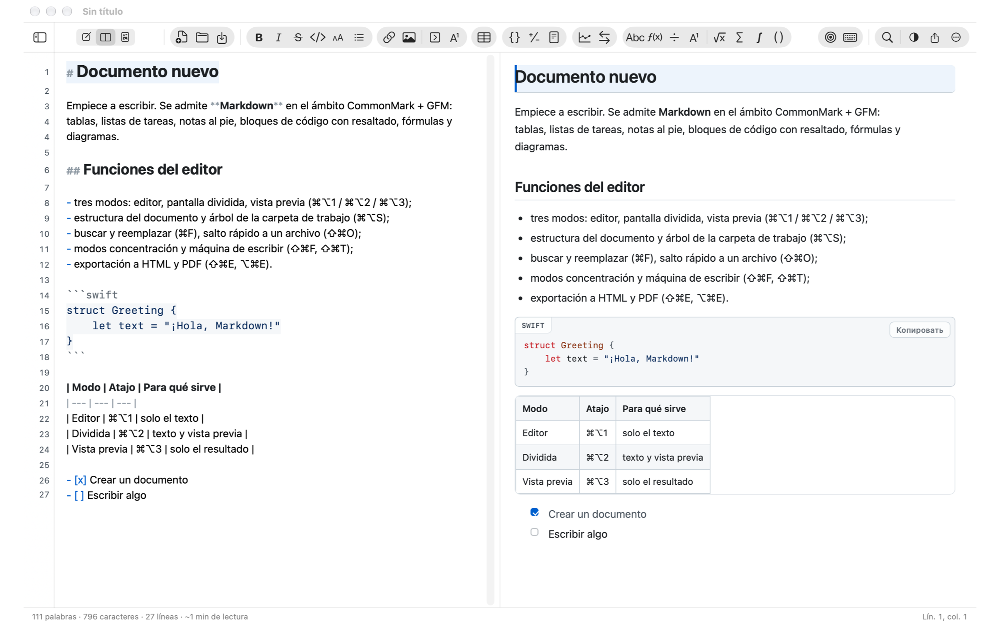
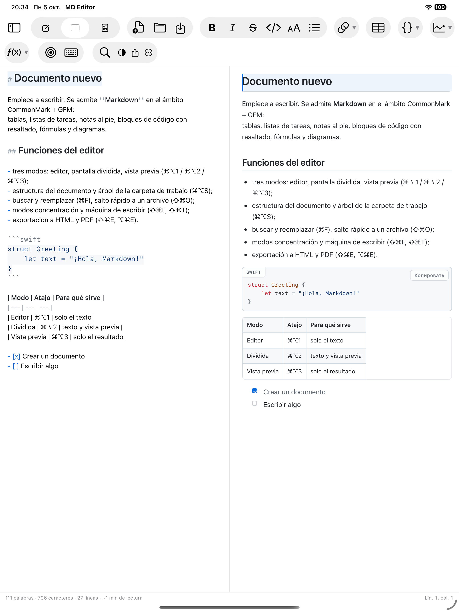
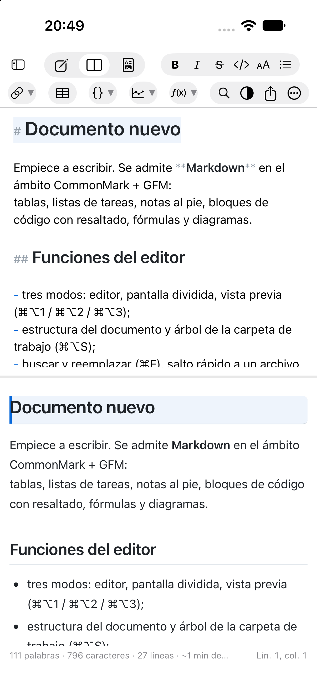
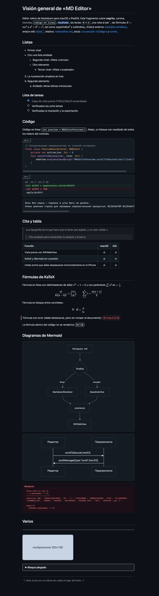
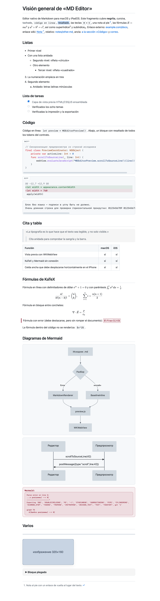

[Русский](README.md) | [English](README.en.md) | [Deutsch](README.de.md) | **Español** | [Français](README.fr.md) | [हिन्दी](README.hi.md)

   [](LICENSE)

# MD Editor

Aplicación multiplataforma para macOS, iPadOS e iOS para ver y editar archivos
en formato **Markdown**. La interfaz reproduce la lógica de un editor de texto estándar: ventana
de documento, barra de herramientas, menú con atajos de teclado habituales y barra de estado.

* Solo archivos `.md`: sin base de datos, sin formatos «propios». Cada documento es
  un archivo de texto normal que se puede guardar en Git, iCloud Drive u Obsidian.
* Un solo código y una sola interfaz para macOS, iPadOS e iOS: el núcleo y la interfaz son comunes,
  y las diferencias están solo en las directivas de plataforma `#if os(...)`.
* Totalmente offline: ninguna dependencia de terceros en tiempo de ejecución, KaTeX y Mermaid van compilados dentro.
* **Ayuda** integrada: se abre desde el menú de ayuda (⌘?) y desde el menú «Más» en iPhone/iPad;
  el texto está en `MDEditor/es.lproj/Help.md` y traducido a los seis idiomas de la aplicación.


Desarrollado por **Sergei Sharov**. La información del autor se ve en la aplicación, en la sección
«Acerca de» (menú ⌘ en macOS, botón «…» en la barra de herramientas en iPad/iPhone):



### Cómo se ve

| macOS | iPadOS |
|---|---|
|  |  |

En iPhone los mismos paneles se colocan uno debajo del otro:

| iPhone |
|---|
|  |

A la izquierda está el editor con resaltado de Markdown (los marcadores de formato están atenuados,
los títulos son más grandes), a la derecha la vista previa: títulos, listas, listas de tareas,
bloque de código con la etiqueta del lenguaje, tabla con alineación. El aspecto de la vista previa
(los mismos temas funcionan también en la exportación):

| Tema oscuro | Tema claro |
|---|---|
|  |  |

Las capturas se tomaron de [`Docs/demo.es.md`](Docs/demo.es.md), un documento de demostración que
cubre todas las posibilidades de la vista previa: resaltado, tres niveles de listas, lista de tareas,
bloques de código (swift, diff y sin lenguaje), cita, tabla con alineación, fórmulas KaTeX con los
cuatro delimitadores, diagramas Mermaid, bloques HTML, nota al pie e inserción de imagen. Para repetirlo:

```bash
"MD Editor.app/Contents/MacOS/MD Editor" --preview-snapshot Docs/demo.md /tmp/demo.png github-light
```

---

## 1. Qué puede hacer la aplicación

### Modos y navegación
* Tres modos: **editor**, **pantalla dividida**, **vista previa** (⌘⌥1 / ⌘⌥2 / ⌘⌥3).
* Sincronización del desplazamiento en ambos sentidos: al desplazar el editor se mueve la vista previa,
  y al desplazar la vista previa se mueve el editor (por números de línea).
* Barra de herramientas: enlace, imagen, **bloque plegable** y **nota al pie con enlace
  de retorno**, tabla, tres **bloques de código** (Swift, diff, sin lenguaje, cada uno con su
  propio ejemplo), dos **diagramas** (diagrama de flujo, secuencia) y ocho **fórmulas**
  (en línea, en bloque, fracción, subíndice y superíndice, raíz, suma, integral, coeficiente
  binomial). Los botones se agrupan en «cápsulas», como en la barra de «Mail»: iconos grandes,
  fondo de grupo bien visible; los bloques se insertan en líneas separadas y el marcador
  de posición se selecciona para reemplazarlo.
* Panel lateral: **estructura del documento** (títulos H1–H6 con salto al hacer clic) y
  **árbol de la carpeta de trabajo** (cualquier carpeta con `.md`, se abre una vez y se recuerda
  mediante security-scoped bookmark).
* Salto rápido a un archivo mediante búsqueda difusa (⇧⌘O), búsqueda/filtro en el árbol de archivos.
* Historial de versiones del documento: instantáneas locales con visualización y restauración (⌃⌘H).

### Editor
* Resaltado de Markdown: títulos de distinto tamaño, negrita/cursiva/tachado, código en línea,
  bloques de código con resaltado de sintaxis (20 lenguajes), enlaces, marcadores de listas, citas,
  tablas, front matter. Los marcadores de formato están atenuados: «casi WYSIWYG», como en iA Writer.
* Entrada inteligente: continuación de listas y numeración con Enter, Tab/Shift+Tab para el anidamiento,
  pares automáticos `(` `[` `` ` `` `*` `_` `~` `"` `'`, envoltura de la selección.
* Inserción de imágenes con ⌘V y drag&drop: el archivo se copia en `assets/` junto a las notas
  y en el texto aparece un enlace relativo. Las rutas con espacios, paréntesis y cirílico
  se escriben de forma legible (entre corchetes angulares) y se abren bien en la vista previa.
* Números de línea, resaltado de la línea actual, modo concentración (⌘⇧F) y modo máquina
  de escribir (⌘⇧T), corrección ortográfica, comillas «inteligentes» desactivadas (para no estropear el Markdown).
* Buscar y reemplazar con resaltado de todas las coincidencias, distinción de mayúsculas, palabras completas
  y expresiones regulares (⌘F / ⌥⌘F).
* Undo/Redo completo, autoguardado, «Versiones» del documento con los medios del sistema.

### Markdown
* CommonMark + GFM: títulos ATX y Setext, listas (anidadas, «compactas» y «sueltas»),
  listas de tareas con casillas **cliqueables** directamente en la vista previa, tablas con alineación,
  citas, bloques de código, notas al pie, enlaces automáticos, bloques HTML, front matter YAML.
* El botón «tabla» inserta tres columnas, una fila de encabezado y **tres filas de datos**;
  las filas de la tabla tienen la misma altura incluso mientras las celdas están vacías.
* Matemáticas KaTeX (`$…$`, `$$…$$`) y diagramas Mermaid: **offline**, desde las
  bibliotecas compiladas dentro.
* Enlaces wiki `[[Nota]]` con salto entre los archivos de la carpeta de trabajo.
* Saltos de línea duros (como en GitHub): un salto de línea simple en un párrafo se muestra
  en la vista previa como una línea real, por lo que las líneas del editor y de la vista previa coinciden
  (ajuste «Markdown → Saltos de línea duros», activado por defecto).
* Selecciones «casi WYSIWYG»: un espacio dentro de `** … **` no impide la negrita ni el tachado,
  tanto en el resaltado del editor como en la vista previa.

### Aspecto
* 8 temas de vista previa con nombres propios: **Tiza**, **Pizarra**, **Papel**, **Pergamino**,
  **Arena**, **Océano**, **Ártico**, **Tinta** (en la interfaz inglesa: Chalk, Slate,
  Paper, Parchment, Sand, Ocean, Arctic, Ink). Por defecto, el esquema claro/oscuro
  sigue al sistema; si se desactiva «Seguir el aspecto del sistema», el tema elegido
  define el esquema de **toda la ventana** (editor, paneles y título), y no solo de
  la vista previa.
* Ajustes de tipografía: familia y tamaño de fuente, interlineado, ancho de columna,
  espaciado entre párrafos, justificación, partición de palabras.
* La familia de fuente es **común para el editor y la vista previa** (pestaña «Editor»),
  mientras que el tamaño de la vista previa es propio (pestaña «Vista previa»); en el primer arranque
  los tamaños son iguales y después cambian de forma independiente.
* Las barras de desplazamiento del editor y de la vista previa están siempre visibles:
  con ellas se ve de inmediato si hay desplazamiento y dónde está el texto.

### Exportación
* HTML autónomo (todo incrustado, incluidas las fuentes de las fórmulas y las **imágenes**), PDF, impresión.
* Las imágenes se incrustan en el archivo final (en PDF y al imprimir, siempre): el documento
  no depende de dónde estén las imágenes originales.
* La exportación no modifica el documento ni requiere escribir junto a él.

### Plataformas
* macOS 14+: target principal, ventanas de documento, menú, «Compartir», impresión.
* iOS 17+ / iPadOS: la misma interfaz; en pantallas estrechas el panel lateral se convierte
  en un cajón deslizante y los paneles del editor y de la vista previa siguen siendo los mismos.
* Localización en seis idiomas: ruso, inglés, alemán, español, francés
  e hindi; la interfaz sigue el idioma del sistema.
* Sección «Acerca de» con la información del autor.

---

## 2. Atajos de teclado

Un documento, una ventana. «Nuevo documento» (⌘N) y «Abrir» (⌘O) funcionan
**en la ventana actual**: primero preguntan por los cambios sin guardar y luego reemplazan
el documento. No se abren ventanas nuevas.

| Acción | Atajo |
|---|---|
| Editor / Dividida / Vista previa | ⌘⌥1 / ⌘⌥2 / ⌘⌥3 |
| Panel lateral | ⌘⌥S |
| Salto rápido a un archivo | ⇧⌘O |
| Abrir la carpeta de trabajo | ⌃⌘O |
| Buscar / Buscar y reemplazar | ⌘F / ⌥⌘F |
| Buscar siguiente / anterior | ⌘G / ⇧⌘G |
| Negrita / Cursiva / Tachado | ⌘B / ⌘I / ⌃⌘X |
| Código en línea / Bloque de código (Swift) | ⌃⌘C / ⌃⌘K |
| Bloque de código Diff / sin lenguaje | — (botones de la barra) |
| Bloque plegable | ⌥⌘E |
| Títulos 1–6 / quitar título | ⌘1…⌘6 / ⌘0 |
| Con viñetas / Numerada / Lista de tareas | ⌥⌘U / ⌥⌘O / ⌥⌘L |
| Cita / Línea horizontal | ⌥⌘Q / ⌥⌘H |
| Enlace / Imagen | ⌘K / ⇧⌘I |
| Tabla / Índice / Nota al pie | ⌥⌘T / ⌃⌘T / ⌃⌘F |
| Diagrama de flujo / Bloque de fórmula | ⌥⌘D / ⌥⌘M |
| Fórmula / Diagrama Mermaid | ⌥⌘M / ⌥⌘D |
| Modo concentración / máquina de escribir | ⇧⌘F / ⇧⌘T |
| Sincronización del desplazamiento | ⇧⌘L |
| Barra de estado | ⌥⌘W |
| Exportar HTML / PDF | ⇧⌘E / ⌥⌘E |
| Imprimir | ⌘P |
| Instantánea del historial / Historial de versiones | ⌃⌘S / ⌃⌘H |
| Ajustes | ⌘, |

---

## 3. Componentes de terceros

| Componente | Versión | Licencia | Uso |
|---|---|---|---|
| [KaTeX](https://katex.org) | 0.16.11 | MIT | renderizado de fórmulas `$…$`, `$$…$$` |
| [Mermaid](https://mermaid.js.org) | 11.4.1 | MIT | diagramas en bloques ```` ```mermaid ```` |

Ambas bibliotecas están en `Web/vendor/` junto con los textos de las licencias
y se cargan localmente: no hace falta internet.

Los textos completos de las licencias están en la app: «Acerca de MD Editor» → «Licencias de terceros».

---

## 4. Licencia

MD Editor es software propietario: © 2026 Sergei Sharov, todos los derechos reservados. Las
condiciones están en el archivo [LICENSE](LICENSE).

Los componentes de terceros (KaTeX y Mermaid) se distribuyen bajo la licencia MIT: sus
textos están en `Web/vendor/licenses/` y se pueden ver en la app — «Acerca de MD Editor» →
«Licencias de terceros».
