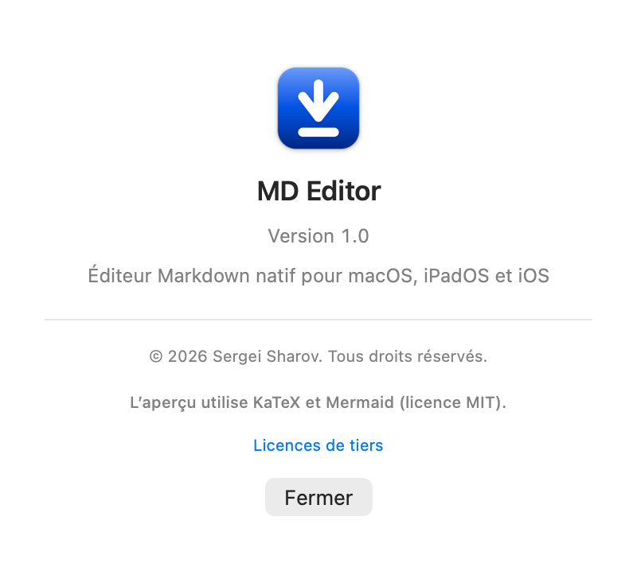
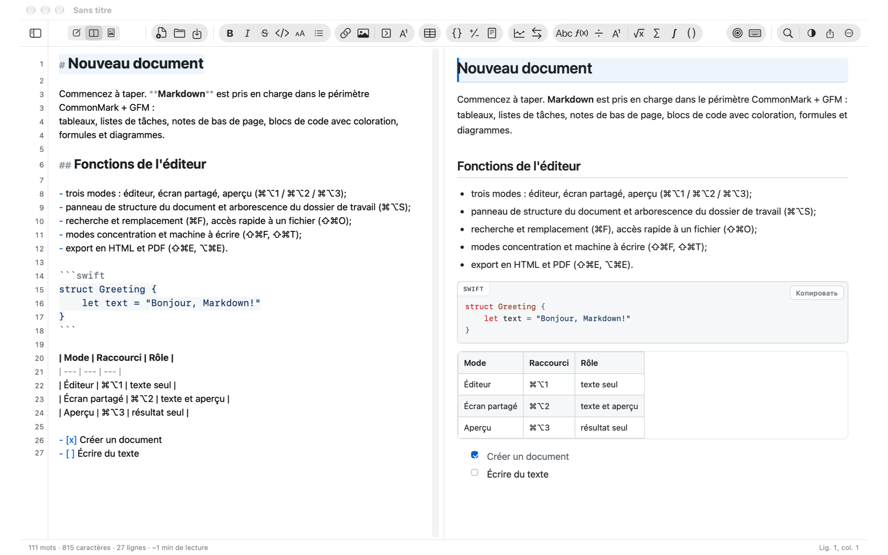
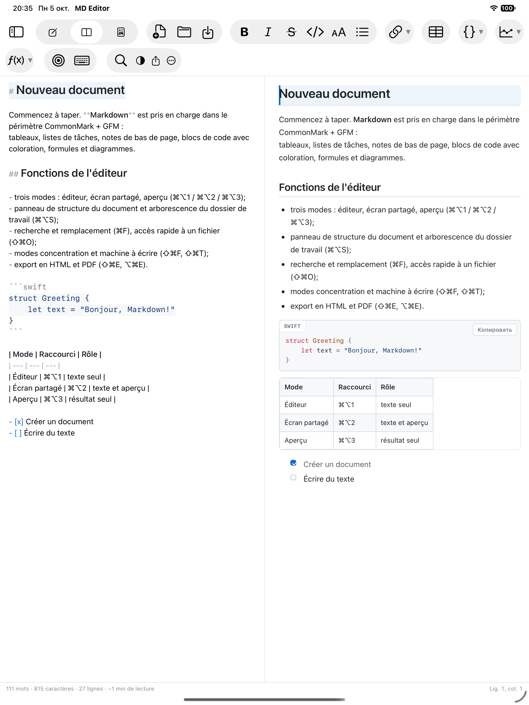
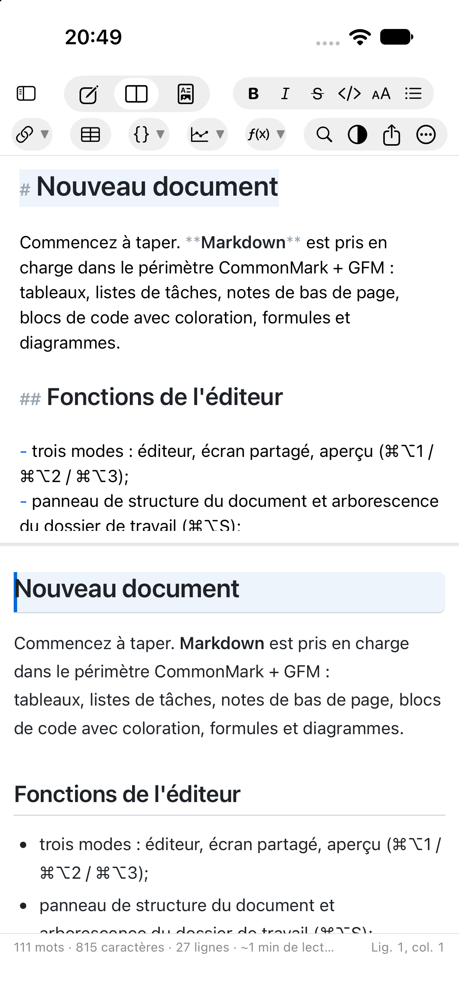
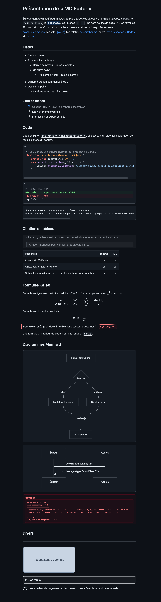
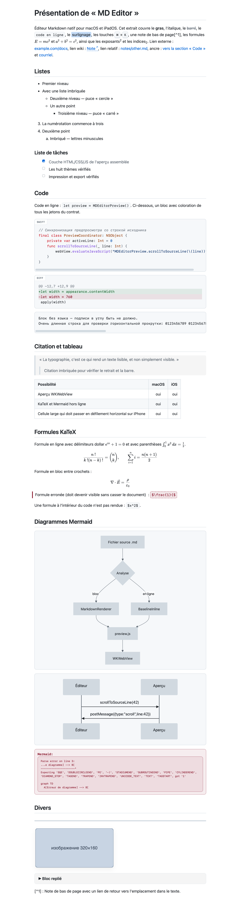

[Русский](README.md) | [English](README.en.md) | [Deutsch](README.de.md) | [Español](README.es.md) | **Français** | [हिन्दी](README.hi.md)

   [](LICENSE)

# MD Editor

Application pour macOS, iPadOS et iOS permettant de consulter et de modifier des fichiers au format
**Markdown** — un seul code et une seule interface. Elle reprend la logique d'un éditeur de texte
classique : fenêtre de document, barre d'outils, menus avec les raccourcis habituels, ligne d'état.

* Uniquement des fichiers `.md` : aucune base de données, aucun format « maison ». Chaque document
  est un simple fichier texte, que l'on peut placer dans Git, iCloud Drive ou Obsidian.
* Un seul code et un seul design pour Mac, iPad et iPhone : le cœur et l'interface sont communs,
  les différences ne tiennent qu'aux directives de plateforme `#if os(...)`.
* Entièrement hors ligne : aucune dépendance tierce à l'exécution, KaTeX et Mermaid sont compilés
  dans l'application.


Développé par **Sergei Sharov**. Les informations sur l'auteur sont visibles dans l'application,
à la rubrique « À propos » (menu ⌘ sur macOS, bouton « … » dans la barre d'outils sur iPad/iPhone) :



### Aperçu

| macOS | iPadOS |
|---|---|
|  |  |

Sur iPhone, les mêmes panneaux sont empilés l'un sous l'autre :

| iPhone |
|---|
|  |

À gauche, l'éditeur avec la coloration Markdown (les marqueurs de balisage sont atténués, les titres
sont plus grands) ; à droite, l'aperçu : titres, listes, listes de tâches, bloc de code avec le nom
du langage, tableau avec alignement. Mise en forme de l'aperçu (les mêmes thèmes s'appliquent aussi
à l'export) :

| Thème sombre | Thème clair |
|---|---|
|  |  |

Les captures d'écran proviennent de [`Docs/demo.fr.md`](Docs/demo.fr.md) — un document de démonstration qui
couvre toutes les possibilités de l'aperçu : coloration, trois niveaux de listes, liste de tâches,
blocs de code (swift, diff et sans langage), citation, tableau avec alignement, formules KaTeX avec
les quatre délimiteurs, diagrammes Mermaid, blocs HTML, note de bas de page et insertion d'image.
Pour reproduire :

```bash
"MD Editor.app/Contents/MacOS/MD Editor" --preview-snapshot Docs/demo.md /tmp/demo.png github-light
```

---

## 1. Ce que l'application sait faire

### Modes et navigation
* Trois modes : **éditeur**, **écran partagé**, **aperçu** (⌘⌥1 / ⌘⌥2 / ⌘⌥3).
* Synchronisation du défilement dans les deux sens : faire défiler l'éditeur entraîne l'aperçu,
  faire défiler l'aperçu entraîne l'éditeur (par numéros de ligne).
* Barre d'outils : lien, image, **bloc repliable** et **note de bas de page avec lien retour**,
  tableau, trois **blocs de code** (Swift, diff, sans langage — chacun avec son exemple), deux
  **diagrammes** (organigramme, séquence) et huit **formules** (en ligne, en bloc, fraction, indice
  et exposant, racine, somme, intégrale, coefficient binomial). Les boutons sont regroupés en
  « capsules », comme dans la barre de « Mail » : grandes icônes, fond de groupe bien visible ; les
  blocs s'insèrent sur des lignes distinctes et l'espace réservé est sélectionné pour être remplacé.
* Panneau latéral : **structure du document** (titres H1–H6 avec navigation au clic) et
  **arborescence du dossier de travail** (tout dossier contenant des `.md`, ouvert une fois et
  mémorisé grâce à un security-scoped bookmark).
* Accès rapide à un fichier par recherche floue (⇧⌘O), recherche/filtre dans l'arborescence.
* Historique des versions du document : instantanés locaux avec consultation et restauration (⌃⌘H).
* Aide intégrée : elle s'ouvre depuis le menu d'aide (⌘?) et depuis le menu « Plus » sur
  iPhone/iPad ; son texte se trouve dans `MDEditor/fr.lproj/Help.md` et est traduit en six langues.

### Éditeur
* Coloration Markdown : titres de tailles différentes, gras/italique/barré, code en ligne,
  blocs de code avec coloration syntaxique (20 langages), liens, puces de listes, citations,
  tableaux, front matter. Les marqueurs de balisage sont atténués — « presque WYSIWYG », comme dans iA Writer.
* Saisie intelligente : poursuite des listes et des numérotations avec Entrée, Tab/Maj+Tab pour
  l'imbrication, paires automatiques `(` `[` `` ` `` `*` `_` `~` `"` `'`, enveloppement de la sélection.
* Insertion d'images par ⌘V et glisser-déposer : le fichier est copié dans `assets/` à côté des notes,
  et une référence relative est insérée dans le texte. Les chemins contenant des espaces, des
  parenthèses et des caractères cyrilliques sont écrits de façon lisible (entre chevrons) et
  s'ouvrent correctement dans l'aperçu.
* Numéros de ligne, mise en évidence de la ligne courante, mode concentration (⌘⇧F) et mode machine
  à écrire (⌘⇧T), vérification orthographique, guillemets « intelligents » désactivés (pour ne pas
  abîmer le Markdown).
* Recherche et remplacement avec mise en évidence de toutes les occurrences, respect de la casse,
  mots entiers et expressions régulières (⌘F / ⌥⌘F).
* Annuler/Rétablir complet, enregistrement automatique, « Versions » du document par le système.

### Markdown
* CommonMark + GFM : titres ATX et Setext, listes (imbriquées, « compactes » et « aérées »), listes
  de tâches avec cases **cliquables** directement dans l'aperçu, tableaux avec alignement, citations,
  blocs de code, notes de bas de page, liens automatiques, blocs HTML, front matter YAML.
* Le bouton « tableau » insère trois colonnes, une ligne d'en-tête et **trois lignes de données** ;
  les lignes du tableau ont la même hauteur, même lorsque les cellules sont vides.
* Mathématiques KaTeX (`$…$`, `$$…$$`) et diagrammes Mermaid — **hors ligne**, à partir de
  bibliothèques intégrées à la compilation.
* Wiki-liens `[[Note]]` avec navigation entre les fichiers du dossier de travail.
* Retours à la ligne forcés (comme sur GitHub) : un simple saut de ligne dans un paragraphe
  s'affiche comme un vrai saut dans l'aperçu, de sorte que les lignes de l'éditeur et celles de
  l'aperçu coïncident (réglage « Markdown → Retours à la ligne forcés », activé par défaut).
* Sélections « presque WYSIWYG » : un espace à l'intérieur de `** … **` n'empêche ni le gras ni le
  barré — aussi bien dans la coloration de l'éditeur que dans l'aperçu.

### Apparence
* 8 thèmes d'aperçu avec leurs noms : **Craie**, **Ardoise**, **Papier**, **Parchemin**, **Sable**,
  **Océan**, **Arctique**, **Encre** (dans l'interface anglaise — Chalk, Slate, Paper, Parchment,
  Sand, Ocean, Arctic, Ink). Par défaut, le schéma clair/sombre suit le système ; si « Suivre
  l'apparence du système » est désactivé, le thème choisi impose le schéma à **toute la fenêtre** —
  éditeur, panneaux et barre de titre, et pas seulement à l'aperçu.
* Réglages typographiques : famille et taille de police, interligne, largeur de colonne, espacement
  entre paragraphes, justification, césures.
* La famille de police est **commune à l'éditeur et à l'aperçu** (onglet « Éditeur »), tandis que
  l'aperçu a sa propre taille (onglet « Aperçu ») ; au premier lancement les tailles sont égales,
  ensuite elles évoluent indépendamment.
* Les barres de défilement de l'éditeur et de l'aperçu sont toujours visibles : on voit d'un coup
  d'œil s'il y a du défilement et où se trouve le texte.

### Export
* HTML autonome (tout est intégré, y compris les polices des formules et les **images**), PDF, impression.
* Les images sont intégrées au fichier produit (toujours en PDF et à l'impression) : le document ne
  dépend pas de l'endroit où se trouvent les images d'origine.
* L'export ne modifie pas le document et n'exige aucune écriture à côté de celui-ci.

### Plateformes
* macOS 14+ — cible principale, fenêtres de document, menus, « Partager », impression.
* iOS 17+ / iPadOS — la même interface : sur les écrans étroits, le panneau latéral devient un
  tiroir coulissant, les panneaux d'éditeur et d'aperçu restent identiques.
* Localisation en six langues : russe, anglais, allemand, espagnol, français et hindi — l'interface
  suit la langue du système.
* Rubrique « À propos » avec les informations sur l'auteur.

---

## 2. Raccourcis clavier

Un document — une fenêtre. « Nouveau document » (⌘N) et « Ouvrir » (⌘O) fonctionnent **dans la fenêtre
courante** : ils demandent d'abord ce qu'il en est des modifications non enregistrées, puis remplacent
le document. Aucune nouvelle fenêtre n'apparaît pour autant.

| Action | Raccourci |
|---|---|
| Éditeur / Écran partagé / Aperçu | ⌘⌥1 / ⌘⌥2 / ⌘⌥3 |
| Panneau latéral | ⌘⌥S |
| Accès rapide à un fichier | ⇧⌘O |
| Ouvrir le dossier de travail | ⌃⌘O |
| Rechercher / Rechercher et remplacer | ⌘F / ⌥⌘F |
| Rechercher le suivant / le précédent | ⌘G / ⇧⌘G |
| Gras / Italique / Barré | ⌘B / ⌘I / ⌃⌘X |
| Code en ligne / Bloc de code (Swift) | ⌃⌘C / ⌃⌘K |
| Bloc de code Diff / sans langage | — (boutons de la barre d'outils) |
| Bloc repliable | ⌥⌘E |
| Titres 1–6 / supprimer le titre | ⌘1…⌘6 / ⌘0 |
| À puces / Numérotée / Liste de tâches | ⌥⌘U / ⌥⌘O / ⌥⌘L |
| Citation / Ligne horizontale | ⌥⌘Q / ⌥⌘H |
| Lien / Image | ⌘K / ⇧⌘I |
| Tableau / Table des matières / Note de bas de page | ⌥⌘T / ⌃⌘T / ⌃⌘F |
| Organigramme / Bloc de formule | ⌥⌘D / ⌥⌘M |
| Formule / Diagramme Mermaid | ⌥⌘M / ⌥⌘D |
| Mode concentration / machine à écrire | ⇧⌘F / ⇧⌘T |
| Synchronisation du défilement | ⇧⌘L |
| Barre d'état | ⌥⌘W |
| Export HTML / PDF | ⇧⌘E / ⌥⌘E |
| Impression | ⌘P |
| Instantané de l'historique / Historique des versions | ⌃⌘S / ⌃⌘H |
| Réglages | ⌘, |

---

## 3. Composants tiers

| Composant | Version | Licence | Rôle |
|---|---|---|---|
| [KaTeX](https://katex.org) | 0.16.11 | MIT | rendu des formules `$…$`, `$$…$$` |
| [Mermaid](https://mermaid.js.org) | 11.4.1 | MIT | diagrammes dans les blocs ```` ```mermaid ```` |

Les deux bibliothèques se trouvent dans `Web/vendor/` avec les textes des licences et sont chargées
localement — aucune connexion internet n'est nécessaire.

Les textes complets des licences sont visibles dans l’application : « À propos de MD Editor » → « Licences de tiers ».

---

## 4. Licence

MD Editor est un logiciel propriétaire : © 2026 Sergei Sharov, tous droits réservés. Les
conditions figurent dans le fichier [LICENSE](LICENSE).

Les composants tiers (KaTeX et Mermaid) sont distribués sous licence MIT : leurs textes se
trouvent dans `Web/vendor/licenses/` et sont visibles dans l’application — « À propos de
MD Editor » → « Licences de tiers ».
