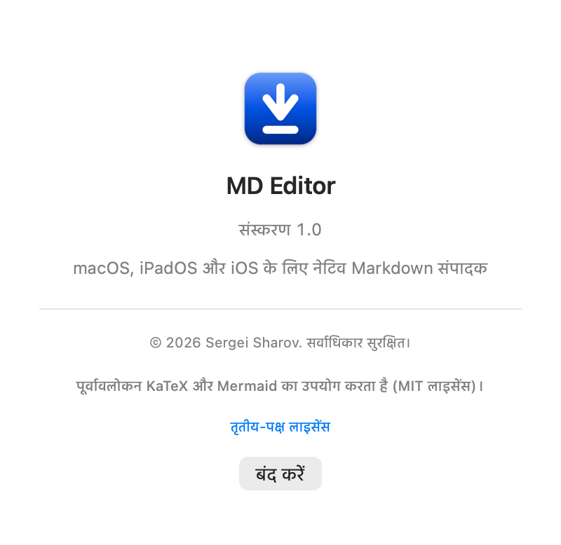
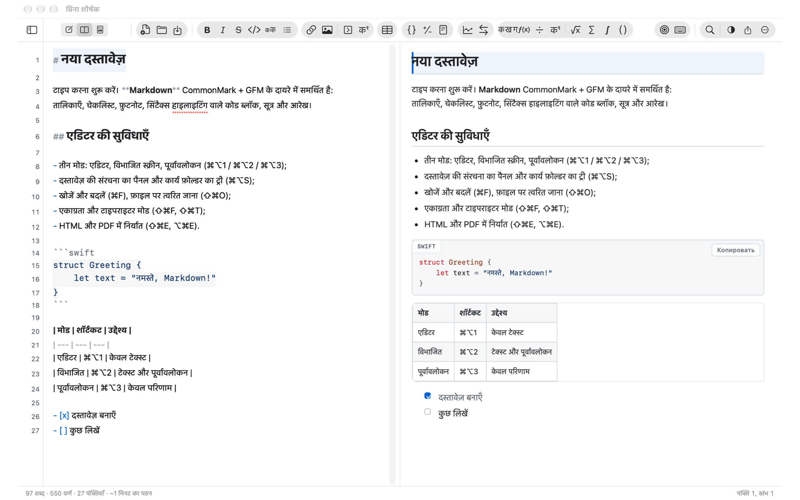
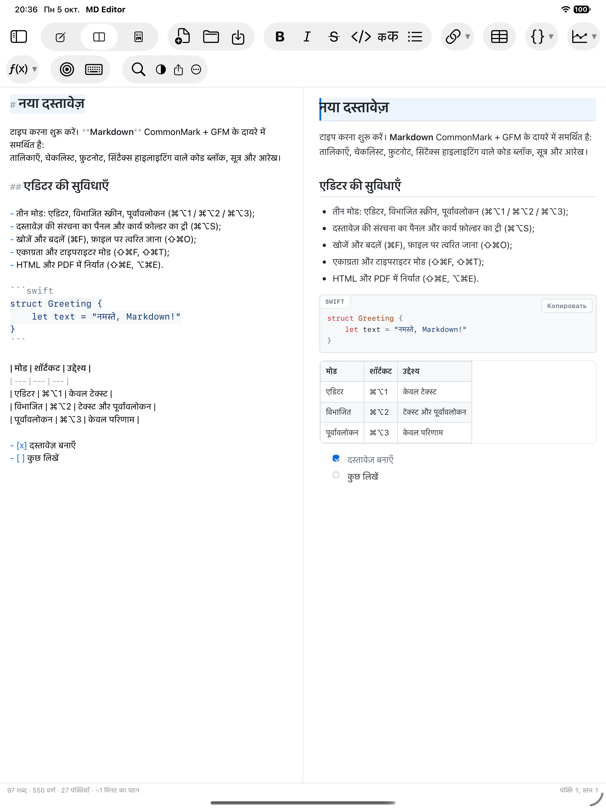
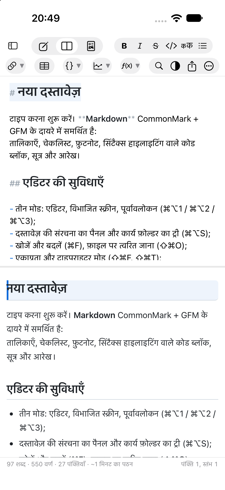
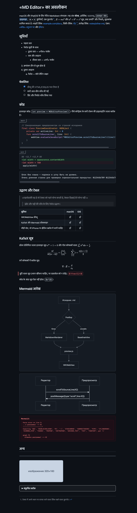
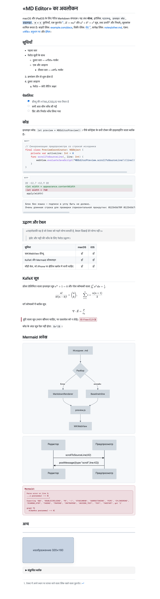

[Русский](README.md) | [English](README.en.md) | [Deutsch](README.de.md) | [Español](README.es.md) | [Français](README.fr.md) | **हिन्दी**

   [](LICENSE)

# MD Editor

**Markdown** फ़ाइलें देखने और संपादित करने वाला क्रॉस-प्लैटफ़ॉर्म ऐप: macOS, iPadOS और
iOS। इसका इंटरफ़ेस मानक टेक्स्ट एडिटर जैसा ही है: दस्तावेज़ की विंडो, टूलबार,
परिचित शॉर्टकट वाला मेन्यू और स्थिति पट्टी।

* केवल `.md` फ़ाइलें: कोई डेटाबेस नहीं, कोई «अपना» फ़ॉर्मैट नहीं। हर दस्तावेज़ एक
  साधारण टेक्स्ट फ़ाइल है, जिसे Git, iCloud Drive या Obsidian में रखा जा सकता है।
* Mac, iPad और iPhone के लिए एक ही कोड और एक ही डिज़ाइन: कोर और इंटरफ़ेस साझा हैं,
  अंतर केवल `#if os(...)` निर्देशों वाली तीन-चार फ़ाइलों में है।
* पूरी तरह ऑफ़लाइन: रनटाइम में एक भी तीसरे पक्ष की निर्भरता नहीं, KaTeX और Mermaid अंदर ही संकलित हैं।


**Sergei Sharov** द्वारा विकसित। लेखक की जानकारी ऐप में «ऐप के बारे में» अनुभाग में दिखती है
(macOS पर ⌘ मेन्यू, iPad/iPhone पर टूलबार का «…» बटन):



### यह कैसा दिखता है

| macOS | iPadOS |
|---|---|
|  |  |

iPhone पर वही पैनल एक के नीचे एक रखे जाते हैं:

| iPhone |
|---|
|  |

बाईं ओर Markdown हाइलाइटिंग वाला एडिटर है (मार्कअप मार्कर धुँधले, शीर्षक बड़े),
दाईं ओर पूर्वावलोकन: शीर्षक, सूचियाँ, चेकलिस्ट, भाषा के लेबल वाला कोड ब्लॉक, संरेखण
वाली तालिका। पूर्वावलोकन का रूप-रंग (वही थीम निर्यात में भी काम करती हैं):

| गहरी थीम | हल्की थीम |
|---|---|
|  |  |

स्क्रीनशॉट [`Docs/demo.hi.md`](Docs/demo.hi.md) से लिए गए हैं — यह प्रदर्शन दस्तावेज़ पूर्वावलोकन
की सभी क्षमताएँ दिखाता है: हाइलाइटिंग, तीन स्तरों वाली सूचियाँ, चेकलिस्ट, कोड ब्लॉक
(swift, diff और बिना भाषा), उद्धरण, संरेखण वाली तालिका, चारों डेलिमिटर वाले KaTeX सूत्र,
Mermaid आरेख, HTML ब्लॉक, फ़ुटनोट और छवि का सम्मिलन। दोहराने के लिए:

```bash
"MD Editor.app/Contents/MacOS/MD Editor" --preview-snapshot Docs/demo.md /tmp/demo.png github-light
```

---

## 1. ऐप क्या-क्या कर सकता है

### मोड और नेविगेशन
* तीन मोड: **एडिटर**, **विभाजित स्क्रीन**, **पूर्वावलोकन** (⌘⌥1 / ⌘⌥2 / ⌘⌥3)।
* दोनों दिशाओं में स्क्रॉल का सिंक: एडिटर स्क्रॉल करने पर पूर्वावलोकन चलता है,
  पूर्वावलोकन स्क्रॉल करने पर एडिटर (पंक्ति संख्याओं के अनुसार)।
* टूलबार: लिंक, छवि, **संकुचित ब्लॉक** और **बैकलिंक वाला फ़ुटनोट**, तालिका, तीन
  **कोड ब्लॉक** (Swift, diff, बिना भाषा — हर एक का अपना उदाहरण), दो **आरेख**
  (फ़्लोचार्ट, अनुक्रम) और आठ **सूत्र** (इनलाइन, ब्लॉक, भिन्न, अधोलेख और घातांक,
  मूल, योग, समाकल, द्विपद गुणांक)। बटन «कैप्सूल» में जुटे हैं, जैसे «मेल» के टूलबार
  में: बड़े आइकन, समूह की स्पष्ट पृष्ठभूमि; ब्लॉक अलग पंक्तियों में आते हैं और बदलने
  के लिए प्लेसहोल्डर चुना जाता है।
* साइडबार: **दस्तावेज़ की संरचना** (H1–H6 शीर्षक, क्लिक करके उन पर जाएँ) और
  **कार्य फ़ोल्डर का ट्री** (`.md` वाला कोई भी फ़ोल्डर, एक बार खुलता है और
  security-scoped bookmark से याद रहता है)।
* फ़ज़ी खोज से फ़ाइल पर त्वरित जाना (⇧⌘O), फ़ाइल ट्री में खोज/फ़िल्टर।
* दस्तावेज़ का वर्शन इतिहास: देखने और बहाल करने योग्य स्थानीय स्नैपशॉट (⌃⌘H)।
* अंदर ही बनी मदद: सहायता मेन्यू (⌘?) से और iPhone/iPad पर «और» मेन्यू से खुलती है;
  उसका टेक्स्ट `MDEditor/hi.lproj/Help.md` में है और छह भाषाओं में अनुवादित है।

### एडिटर
* Markdown हाइलाइटिंग: अलग-अलग आकार के शीर्षक, बोल्ड/इटैलिक/स्ट्राइकथ्रू, इनलाइन कोड,
  सिंटैक्स हाइलाइटिंग वाले कोड ब्लॉक (20 भाषाएँ), लिंक, सूची मार्कर, उद्धरण,
  तालिकाएँ, front matter। मार्कअप मार्कर धुँधले हैं — «लगभग WYSIWYG», iA Writer की तरह।
* स्मार्ट इनपुट: Enter से सूचियाँ और क्रमांकन जारी, नेस्टिंग के लिए Tab/Shift+Tab,
  ऑटो-जोड़े `(` `[` `` ` `` `*` `_` `~` `"` `'`, चयन को लपेटना।
* ⌘V और drag&drop से छवि का सम्मिलन: फ़ाइल नोट्स के पास `assets/` में कॉपी होती है,
  टेक्स्ट में सापेक्ष लिंक जाता है। स्पेस, कोष्ठक और सिरिलिक वाले पथ पठनीय रूप में
  (कोणीय कोष्ठकों में) लिखे जाते हैं और पूर्वावलोकन में ठीक खुलते हैं।
* पंक्ति संख्याएँ, वर्तमान पंक्ति की हाइलाइटिंग, एकाग्रता मोड (⌘⇧F) और टाइपराइटर
  मोड (⌘⇧T), वर्तनी की जाँच, «स्मार्ट» उद्धरण बंद (ताकि Markdown ख़राब न हो)।
* सभी मिलानों की हाइलाइटिंग के साथ खोज और बदलें, केस का ध्यान, पूरे शब्द और रेगुलर
  एक्सप्रेशन (⌘F / ⌥⌘F)।
* पूरा Undo/Redo, ऑटोसेव, सिस्टम के ज़रिए दस्तावेज़ के «वर्शन»।

### Markdown
* CommonMark + GFM: ATX और Setext शीर्षक, सूचियाँ (नेस्टेड, «सघन» और «विरल»),
  पूर्वावलोकन में सीधे **क्लिक करने योग्य** चेकबॉक्स वाली चेकलिस्ट, संरेखण वाली तालिकाएँ,
  उद्धरण, कोड ब्लॉक, फ़ुटनोट, ऑटोलिंक, HTML ब्लॉक, YAML front matter।
* «तालिका» बटन तीन स्तंभ, शीर्षक की पंक्ति और **तीन डेटा पंक्तियाँ** डालता है;
  खाली सेल रहने पर भी तालिका की पंक्तियाँ समान ऊँचाई की होती हैं।
* KaTeX गणित (`$…$`, `$$…$$`) और Mermaid आरेख — **ऑफ़लाइन**, अंदर संकलित
  लाइब्रेरी से।
* विकी-लिंक `[[नोट]]`, कार्य फ़ोल्डर की फ़ाइलों पर जाने के साथ।
* हार्ड लाइन ब्रेक (GitHub की तरह): पैराग्राफ़ में अकेला न्यूलाइन पूर्वावलोकन में
  असली पंक्ति बनकर दिखता है, इसलिए एडिटर और पूर्वावलोकन की पंक्तियाँ मेल खाती हैं
  (सेटिंग «Markdown → हार्ड लाइन ब्रेक», डिफ़ॉल्ट रूप से चालू)।
* «लगभग WYSIWYG» हाइलाइटिंग: `** … **` के अंदर का स्पेस बोल्ड और स्ट्राइकथ्रू को नहीं
  रोकता — एडिटर की हाइलाइटिंग और पूर्वावलोकन, दोनों में।

### रूप-रंग
* पूर्वावलोकन की 8 थीम, अपने नामों के साथ: **चॉक**, **स्लेट**, **कागज़**, **चर्मपत्र**,
  **रेत**, **महासागर**, **आर्कटिक**, **स्याही** (अंग्रेज़ी इंटरफ़ेस में — Chalk, Slate,
  Paper, Parchment, Sand, Ocean, Arctic, Ink)। डिफ़ॉल्ट रूप से हल्की/गहरी स्कीम
  सिस्टम का अनुसरण करती है; अगर «सिस्टम के रूप-रंग का अनुसरण करें» बंद कर दें, तो चुनी
  गई थीम **पूरी विंडो** की स्कीम तय करती है — एडिटर, पैनल और शीर्षक की, न कि केवल
  पूर्वावलोकन की।
* टाइपोग्राफ़ी की सेटिंग: फ़ॉन्ट परिवार और आकार, पंक्ति अंतराल, कॉलम की चौड़ाई,
  पैराग्राफ़ों के बीच का अंतर, दोनों ओर संरेखण, हाइफ़नेशन।
* फ़ॉन्ट परिवार **एडिटर और पूर्वावलोकन के लिए साझा** है («एडिटर» टैब),
  जबकि पूर्वावलोकन का आकार अपना है («पूर्वावलोकन» टैब); पहली बार चलाने पर आकार
  बराबर होते हैं, आगे स्वतंत्र रूप से बदलते हैं।
* एडिटर और पूर्वावलोकन में स्क्रॉलबार हमेशा दिखते हैं: उनसे तुरंत पता चलता है
  कि स्क्रॉल है या नहीं और टेक्स्ट कहाँ है।

### निर्यात
* स्वतंत्र HTML (सब कुछ अंदर, सूत्रों के फ़ॉन्ट और **चित्रों** सहित), PDF, प्रिंट।
* छवियाँ तैयार फ़ाइल में अंदर ही जुड़ती हैं (PDF और प्रिंट में — हमेशा): दस्तावेज़
  इस पर निर्भर नहीं करता कि मूल चित्र कहाँ पड़े हैं।
* निर्यात दस्तावेज़ को नहीं बदलता और उसके पास लिखने की ज़रूरत नहीं होती।

### प्लैटफ़ॉर्म
* macOS 14+ — मुख्य टारगेट, दस्तावेज़ की विंडो, मेन्यू, «साझा करें», प्रिंट।
* iOS 17+ / iPadOS — वही इंटरफ़ेस: संकरी स्क्रीन पर साइडबार खिसकने वाला दराज़ बन
  जाता है, एडिटर और पूर्वावलोकन के पैनल वही रहते हैं।
* छह भाषाओं में स्थानीयकरण: रूसी, अंग्रेज़ी, जर्मन, स्पेनिश, फ़्रेंच
  और हिन्दी — इंटरफ़ेस सिस्टम की भाषा का अनुसरण करता है।
* लेखक की जानकारी वाला «ऐप के बारे में» अनुभाग।

---

## 2. शॉर्टकट

एक दस्तावेज़ — एक विंडो। «नया दस्तावेज़» (⌘N) और «खोलें» (⌘O)
**वर्तमान विंडो में** काम करते हैं: पहले बिना सहेजे बदलावों के बारे में पूछते हैं, फिर
दस्तावेज़ बदल देते हैं। नई विंडो नहीं खुलतीं।

| क्रिया | शॉर्टकट |
|---|---|
| एडिटर / विभाजित / पूर्वावलोकन | ⌘⌥1 / ⌘⌥2 / ⌘⌥3 |
| साइडबार | ⌘⌥S |
| फ़ाइल पर त्वरित जाना | ⇧⌘O |
| कार्य फ़ोल्डर खोलें | ⌃⌘O |
| खोजें / खोजें और बदलें | ⌘F / ⌥⌘F |
| अगला / पिछला खोजें | ⌘G / ⇧⌘G |
| बोल्ड / इटैलिक / स्ट्राइकथ्रू | ⌘B / ⌘I / ⌃⌘X |
| इनलाइन कोड / कोड ब्लॉक (Swift) | ⌃⌘C / ⌃⌘K |
| Diff कोड ब्लॉक / बिना भाषा | — (टूलबार के बटन) |
| संकुचित ब्लॉक | ⌥⌘E |
| शीर्षक 1–6 / शीर्षक हटाएँ | ⌘1…⌘6 / ⌘0 |
| बुलेट / क्रमांकित / चेकलिस्ट | ⌥⌘U / ⌥⌘O / ⌥⌘L |
| उद्धरण / क्षैतिज रेखा | ⌥⌘Q / ⌥⌘H |
| लिंक / छवि | ⌘K / ⇧⌘I |
| तालिका / विषय-सूची / फ़ुटनोट | ⌥⌘T / ⌃⌘T / ⌃⌘F |
| फ़्लोचार्ट / सूत्र का ब्लॉक | ⌥⌘D / ⌥⌘M |
| सूत्र / Mermaid आरेख | ⌥⌘M / ⌥⌘D |
| एकाग्रता मोड / टाइपराइटर | ⇧⌘F / ⇧⌘T |
| स्क्रॉल का सिंक | ⇧⌘L |
| स्थिति पट्टी | ⌥⌘W |
| HTML / PDF निर्यात | ⇧⌘E / ⌥⌘E |
| प्रिंट | ⌘P |
| इतिहास का स्नैपशॉट / वर्शन इतिहास | ⌃⌘S / ⌃⌘H |
| सेटिंग | ⌘, |

---

## 3. तीसरे पक्ष के घटक

| घटक | संस्करण | लाइसेंस | उद्देश्य |
|---|---|---|---|
| [KaTeX](https://katex.org) | 0.16.11 | MIT | सूत्रों `$…$`, `$$…$$` की रेंडरिंग |
| [Mermaid](https://mermaid.js.org) | 11.4.1 | MIT | ```` ```mermaid ```` ब्लॉक में आरेख |

दोनों लाइब्रेरी लाइसेंस के पाठों सहित `Web/vendor/` में हैं
और स्थानीय रूप से लोड होती हैं — इंटरनेट की ज़रूरत नहीं।

लाइसेंस के पूरे पाठ ऐप में देखे जा सकते हैं: «MD Editor के बारे में» → «तृतीय-पक्ष लाइसेंस»।

---

## 4. लाइसेंस

MD Editor एक स्वामित्व वाला सॉफ़्टवेयर है: © 2026 Sergei Sharov, सर्वाधिकार सुरक्षित। शर्तें
[LICENSE](LICENSE) फ़ाइल में हैं।

तृतीय-पक्ष घटक (KaTeX और Mermaid) MIT लाइसेंस के अंतर्गत वितरित होते हैं: उनके पाठ
`Web/vendor/licenses/` में हैं और ऐप में देखे जा सकते हैं — «MD Editor के बारे में» →
«तृतीय-पक्ष लाइसेंस»।
