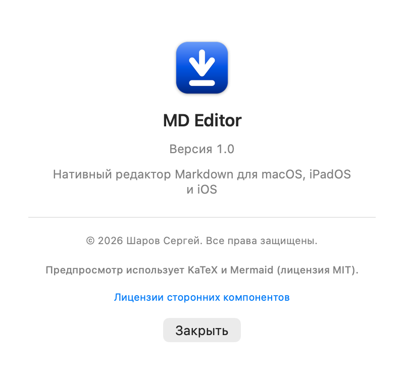
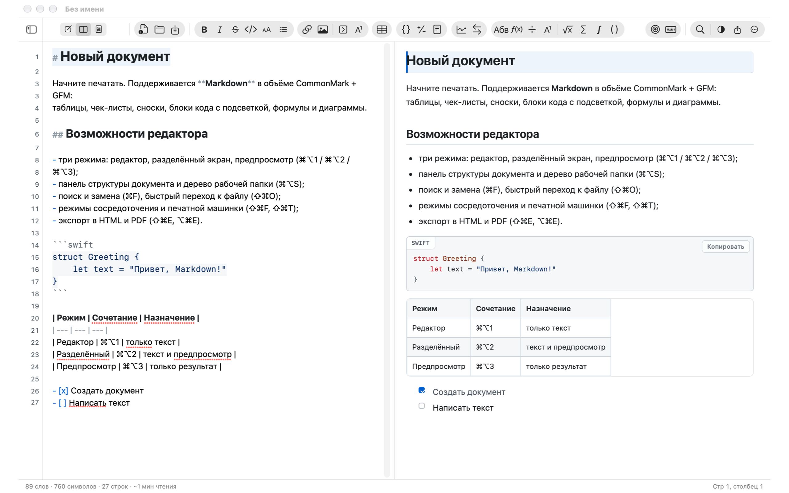
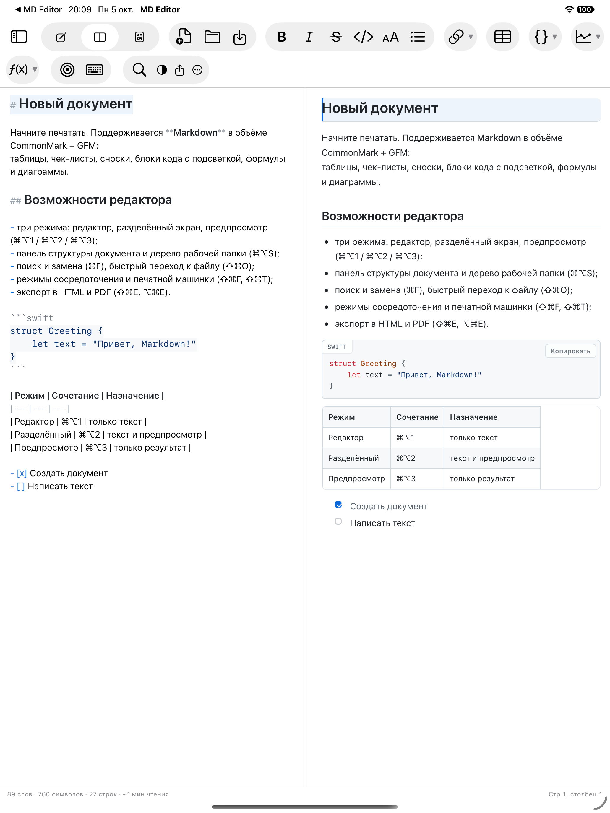
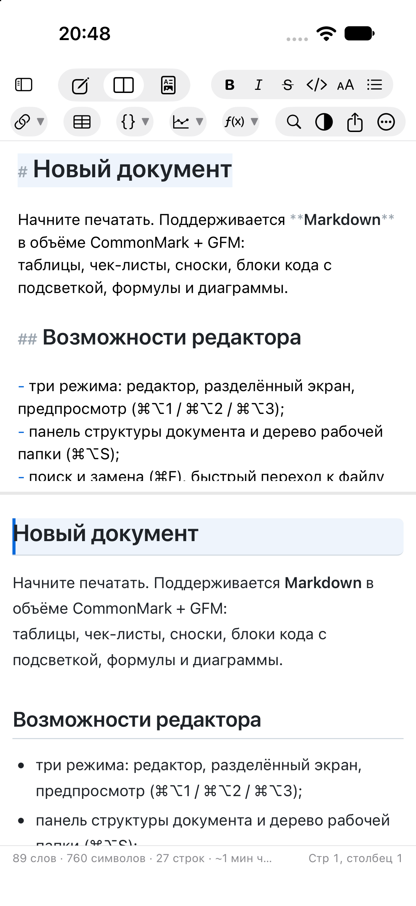
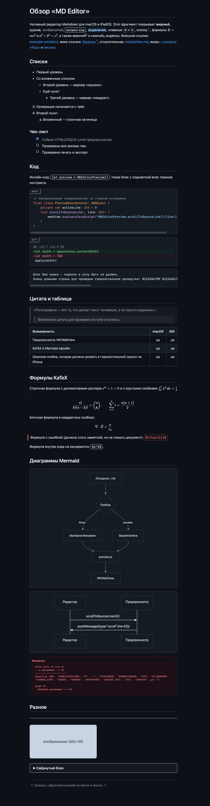
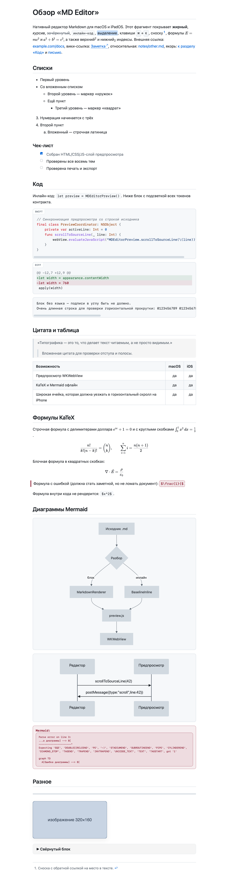

**Русский** | [English](README.en.md) | [Deutsch](README.de.md) | [Español](README.es.md) | [Français](README.fr.md) | [हिन्दी](README.hi.md)

   [](LICENSE)

# MD Editor

Кросс-платформенное приложение для macOS, iPadOS и iOS для просмотра и редактирования файлов
формата **Markdown**. Интерфейс повторяет логику стандартного текстового редактора: окно
документа, панель инструментов, меню с привычными сочетаниями клавиш, строка состояния.

* Только `.md`-файлы: никакой базы данных, никаких «своих» форматов. Каждый документ —
  обычный текстовый файл, который можно положить в Git, iCloud Drive или Obsidian.
* Один код и один дизайн для Mac, iPad и iPhone: ядро и интерфейс общие, различия —
  в трёх-четырёх файлах с директивами `#if os(...)`.
* Полностью офлайн: ни одной сторонней зависимости в рантайме, KaTeX и Mermaid вкомпилированы.
* Встроенная **справка** (⌘? или меню «Ещё» на iPhone/iPad): разделы о режимах, вставке,
  поиске, темах, экспорте и горячих клавишах — на всех шести языках приложения.


Автор: **Шаров Сергей**. Сведения об авторе видны в приложении в разделе
«О программе» (⌘-меню на macOS, кнопка «…» в панели инструментов на iPad/iPhone):



### Как это выглядит

| macOS | iPadOS |
|---|---|
|  |  |

На iPhone те же панели располагаются друг под другом:

| iPhone |
|---|
|  |

Слева — редактор с подсветкой Markdown (маркеры разметки приглушены, заголовки крупнее),
справа — предпросмотр: заголовки, списки, чек-листы, блок кода с подписью языка, таблица
с выравниванием. Оформление предпросмотра (те же темы работают и в экспорте):

| Тёмная тема | Светлая тема |
|---|---|
|  |  |

Скриншоты сняты с [`Docs/demo.md`](Docs/demo.md) — демонстрационного документа, который
покрывает все возможности предпросмотра: подсветку, три уровня списков, чек-лист, блоки кода
(swift, diff и без языка), цитату, таблицу с выравниванием, формулы KaTeX всеми четырьмя
делимитерами, диаграммы Mermaid, HTML-блоки, сноску и вставку изображения. Повторить:

```bash
"MD Editor.app/Contents/MacOS/MD Editor" --preview-snapshot Docs/demo.md /tmp/demo.png github-light
```

---

## 1. Что умеет приложение

### Режимы и навигация
* Три режима: **редактор**, **разделённый экран**, **предпросмотр** (⌘⌥1 / ⌘⌥2 / ⌘⌥3).
* Синхронизация прокрутки в обе стороны: прокрутка редактора ведёт предпросмотр,
  прокрутка предпросмотра — редактор (по номерам строк).
* Панель инструментов: ссылка, изображение, **свёрнутый блок** и **сноска с обратной
  ссылкой**, таблица, три **блока кода** (Swift, diff, без языка — каждый со своим
  примером), две **диаграммы** (блок-схема, последовательность) и восемь **формул**
  (в строке, блоком, дробь, индекс и степень, корень, сумма, интеграл, биномиальный
  коэффициент). Кнопки собраны в «капсулы», как в панели «Почты»: крупные значки,
  заметная подложка группы; блоки встают отдельными строками, заполнитель выделяется
  для замены.
* Боковая панель: **структура документа** (заголовки H1–H6 с переходом по клику) и
  **дерево рабочей папки** (любая папка с `.md`, открывается один раз и запоминается
  через security-scoped bookmark).
* Быстрый переход к файлу по нечёткому поиску (⇧⌘O), поиск/фильтр в дереве файлов.
* История версий документа: локальные снапшоты с просмотром и восстановлением (⌃⌘H).

### Редактор
* Подсветка Markdown: заголовки разного кегля, жирный/курсив/зачёркнутый, инлайн-код,
  блоки кода с подсветкой синтаксиса (20 языков), ссылки, маркеры списков, цитаты,
  таблицы, front matter. Маркеры разметки приглушены — «почти WYSIWYG», как в iA Writer.
* Умный ввод: продолжение списков и нумерации по Enter, Tab/Shift+Tab для вложенности,
  авто-пары `(` `[` `` ` `` `*` `_` `~` `"` `'`, оборачивание выделения.
* Вставка изображений через ⌘V и drag&drop: файл копируется в `assets/` рядом с заметками,
  в текст попадает относительная ссылка. Пути с пробелами, скобками и кириллицей
  записываются читаемо (в угловых скобках) и корректно открываются в предпросмотре.
* Номера строк, подсветка текущей строки, режим сосредоточения (⌘⇧F) и режим печатной
  машинки (⌘⇧T), проверка орфографии, отключённые «умные» кавычки (чтобы не портить Markdown).
* Поиск и замена с подсветкой всех вхождений, учётом регистра, целых слов и регулярных
  выражений (⌘F / ⌥⌘F).
* Полноценный Undo/Redo, автосохранение, «Версии» документа средствами системы.

### Markdown
* CommonMark + GFM: заголовки ATX и Setext, списки (вложенные, «плотные» и «рыхлые»),
  чек-листы с **кликабельными** чекбоксами прямо в предпросмотре, таблицы с выравниванием,
  цитаты, блоки кода, сноски, автоссылки, HTML-блоки, front matter YAML.
* Кнопка «таблица» вставляет три столбца, строку заголовка и **три строки данных**;
  строки таблицы одинаковой высоты, даже пока ячейки пустые.
* Математика KaTeX (`$…$`, `$$…$$`) и диаграммы Mermaid — **офлайн**, из вкомпилированных
  библиотек.
* Wiki-ссылки `[[Заметка]]` с переходом по файлам рабочей папки.
* Жёсткие переносы строк (как на GitHub): одиночный перевод строки в абзаце показывается
  в предпросмотре настоящей строкой, поэтому строки редактора и предпросмотра совпадают
  (настройка «Markdown → Жёсткие переносы строк», включена по умолчанию).
* «Почти WYSIWYG» выделения: пробел внутри `** … **` не мешает жирному и зачёркиванию —
  как в подсветке редактора, так и в предпросмотре.

### Оформление
* 8 тем предпросмотра со своими именами: **Мел**, **Грифель**, **Бумага**, **Пергамент**,
  **Песок**, **Океан**, **Арктика**, **Тушь** (в английском интерфейсе — Chalk, Slate,
  Paper, Parchment, Sand, Ocean, Arctic, Ink). По умолчанию светлая/тёмная схема
  следует за системой; если выключить «Следовать оформлению системы», выбранная тема
  задаёт схему **всему окну** — редактору, панелям и заголовку, а не только
  предпросмотру.
* Настройка типографики: семейство и размер шрифта, межстрочный интервал, ширина колонки,
  отступы между абзацами, выравнивание по ширине, переносы.
* Семейство шрифта — **общее для редактора и предпросмотра** (вкладка «Редактор»),
  а размер у предпросмотра свой (вкладка «Предпросмотр»); при первом запуске размеры
  равны, дальше меняются независимо.
* Полосы прокрутки в редакторе и предпросмотре видны всегда: по ним сразу понятно,
  есть ли прокрутка и где находится текст.

### Экспорт
* Автономный HTML (всё встроено, включая шрифты формул и **картинки**), PDF, печать.
* Изображения встраиваются в готовый файл (в PDF и при печати — всегда): документ
  не зависит от того, где лежат исходные картинки.
* Экспорт не меняет документ и не требует записи рядом с ним.

### Связь с системой
* **Открыть из Finder**: «Открыть с помощью», перетаскивание на значок и `open -a`
  открывают заметку в окне; папку можно открыть рабочей прямо из Finder.
* **Пробел в Finder** (Quick Look) показывает заметку отрендеренной: заголовки, списки,
  цитаты, блоки кода и ссылки, в светлой или тёмной теме по оформлению системы.
  Таблицы, формулы и диаграммы показываются текстом — для их отрисовки нужен WebKit,
  который в расширении быстрого просмотра недоступен.
* **Службы**: выделенный в любом приложении текст становится заметкой («Новая заметка
  в MD Editor»), выбранные в Finder файлы открываются документом.
* **Недавние документы** — в меню «Файл» и в меню значка в Dock, вместе с «Новый
  документ» и «Открыть папку».
* **Поиск Spotlight** находит заметки по заголовку и тексту; **«Команды» и Siri**
  умеют создавать заметку, дописывать в текущую и открывать заметку по имени.
* **Ссылки `mdeditor://`**: `mdeditor://new?text=…` — новая заметка с текстом,
  `mdeditor://open?name=…` — заметка из рабочей папки.
* **Буфер обмена**: ⇧⌘C кладёт HTML предпросмотра (вставляется форматированным
  текстом в Mail, Notes и Pages), ⌥⌘C — путь документа, ⇧⌘R — показать в Finder.
* **Handoff**: заметку можно продолжить на другом устройстве.
* Приложение можно назначить обработчиком `.md` по умолчанию — в настройках,
  на вкладке «Поведение».

### Платформы
* macOS 14+ — основной таргет, документные окна, меню, «Поделиться», печать.
* iOS 17+ / iPadOS — тот же интерфейс: на узких экранах боковая панель превращается
  в выдвижной ящик, панели редактора и предпросмотра остаются теми же.
* Локализация на шесть языков: русский, английский, немецкий, испанский, французский
  и хинди — интерфейс следует языку системы.
* Раздел «О программе» со сведениями об авторе.

---

## 2. Горячие клавиши

Один документ — одно окно. «Новый документ» (⌘N) и «Открыть» (⌘O) работают
**в текущем окне**: сначала спрашивают про несохранённые изменения, затем заменяют
документ. Новые окна при этом не появляются.

| Действие | Сочетание |
|---|---|
| Редактор / Разделённый / Предпросмотр | ⌘⌥1 / ⌘⌥2 / ⌘⌥3 |
| Боковая панель | ⌘⌥S |
| Быстрый переход к файлу | ⇧⌘O |
| Открыть рабочую папку | ⌃⌘O |
| Поиск / Поиск и замена | ⌘F / ⌥⌘F |
| Найти далее / ранее | ⌘G / ⇧⌘G |
| Жирный / Курсив / Зачёркнутый | ⌘B / ⌘I / ⌃⌘X |
| Инлайн-код / Блок кода (Swift) | ⌃⌘C / ⌃⌘K |
| Блок кода Diff / без языка | — (кнопки панели) |
| Свёрнутый блок | ⌥⌘E |
| Заголовки 1–6 / снять заголовок | ⌘1…⌘6 / ⌘0 |
| Маркированный / Нумерованный / Чек-лист | ⌥⌘U / ⌥⌘O / ⌥⌘L |
| Цитата / Горизонтальная линия | ⌥⌘Q / ⌥⌘H |
| Ссылка / Изображение | ⌘K / ⇧⌘I |
| Таблица / Оглавление / Сноска | ⌥⌘T / ⌃⌘T / ⌃⌘F |
| Блок-схема / Блок формулой | ⌥⌘D / ⌥⌘M |
| Формула / Диаграмма Mermaid | ⌥⌘M / ⌥⌘D |
| Режим сосредоточения / Печатной машинки | ⇧⌘F / ⇧⌘T |
| Синхронизация прокрутки | ⇧⌘L |
| Панель состояния | ⌥⌘W |
| Экспорт HTML / PDF | ⇧⌘E / ⌥⌘E |
| Копировать HTML предпросмотра | ⇧⌘C |
| Копировать путь документа | ⌥⌘C |
| Показать документ в Finder | ⇧⌘R |
| Печать | ⌘P |
| Снапшот истории / История версий | ⌃⌘S / ⌃⌘H |
| Настройки | ⌘, |

---

## 3. Сторонние компоненты

| Компонент | Версия | Лицензия | Назначение |
|---|---|---|---|
| [KaTeX](https://katex.org) | 0.16.11 | MIT | отрисовка формул `$…$`, `$$…$$` |
| [Mermaid](https://mermaid.js.org) | 11.4.1 | MIT | диаграммы в блоках ```` ```mermaid ```` |

Обе библиотеки лежат в `Web/vendor/` вместе с текстами лицензий
и загружаются локально — интернет не требуется.

Полные тексты лицензий можно посмотреть в приложении: «О программе MD Editor» → «Лицензии сторонних компонентов».

---

## 4. Что дальше

* **«Поделиться → MD Editor» на iPhone и iPad** — отложено до следующей версии: нужна
  возможность App Groups в аккаунте разработчика. Пока сценарий «отправить текст
  в MD Editor» закрывают служба на macOS, ссылки `mdeditor://` и Handoff.
* **Протяжка перегородки в UI-тестах**: `ToolbarUITests` сообщает, что панель редактора
  не расширяется при перетаскивании разделителя. Дефект есть и в сборках до работ по
  системной интеграции — нужна отдельная правка.
* **Порядок UI-тестов**: проверка открытия файла в уже запущенном приложении проходит
  отдельно, но падает в полном наборе — похоже на лишние зарегистрированные копии
  приложения в LaunchServices; проверяется на чистой системе.

---

## 5. Лицензия

«MD Editor» — проприетарное программное обеспечение: © 2026 Шаров Сергей, все права защищены.
Условия использования — в файле [LICENSE](LICENSE).

Сторонние компоненты (KaTeX и Mermaid) распространяются по лицензии MIT: их тексты лежат
в `Web/vendor/licenses/` и доступны в приложении — «О программе» → «Лицензии сторонних
компонентов».
